# Jyotiprakash Mishra

Assistant Professor of Computer Science, KIIT · PhD candidate, BITS Pilani (thesis submitted) · Co-founder and CEO, ENineHQ Technologies

**Website:** [jyotiprakash.org](https://jyotiprakash.org) · **Email:** [mail@jyotiprakash.org](mailto:mail@jyotiprakash.org) · [LinkedIn](https://www.linkedin.com/in/mishrajp88/) · [GitHub](https://github.com/ShowMeTheStack) · [Blog](https://blog.jyotiprakash.org) · [Google Scholar](https://scholar.google.com/citations?user=sE2dRWIAAAAJ) · [ORCID](https://orcid.org/0000-0001-7590-1215)

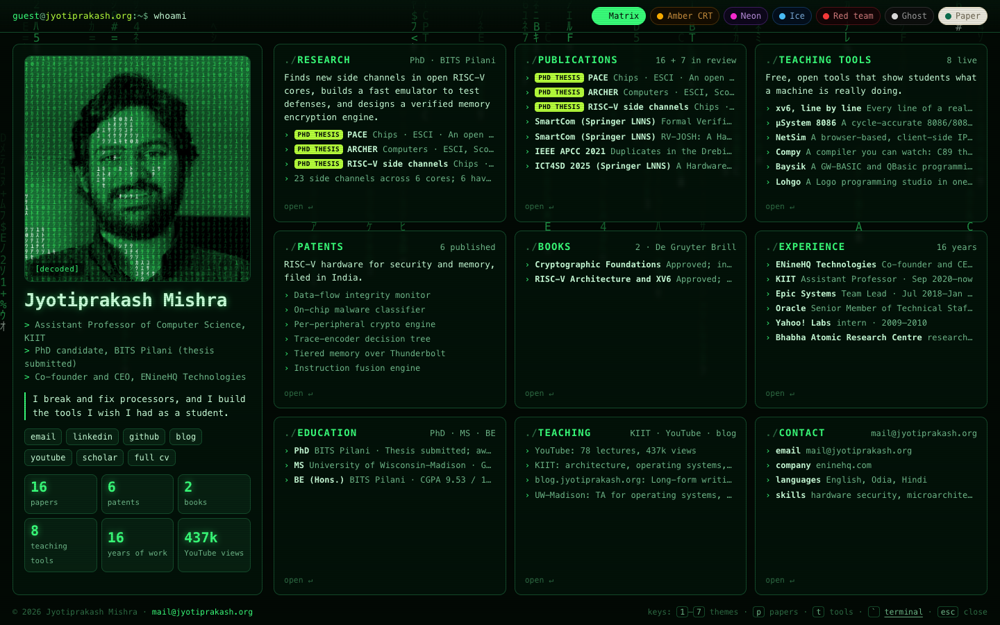

This repository is my website. The page at [jyotiprakash.org](https://jyotiprakash.org) shows everything below at a glance on one screen, with seven themes, and lets you open any item for the detail. This README is the same CV with every section open.

## Contents

- [Profile](#profile)
- [Research](#research)
- [Publications](#publications)
- [Papers under review](#papers-under-review)
- [Patents](#patents)
- [Books](#books)
- [Teaching tools](#teaching-tools)
- [Experience](#experience)
- [Education](#education)
- [Teaching and outreach](#teaching-and-outreach)
- [Honours](#honours)
- [Skills](#skills)
- [Languages](#languages)
- [Contact](#contact)

## Profile

Computer scientist with sixteen years across enterprise software, healthcare technology, university teaching and hardware security research. My doctoral work at BITS Pilani is on the security of open RISC-V processors: microarchitectural side channels, memory encryption and hardware support for detecting malware. Before teaching I spent eight years in industry, as a Team Lead at Epic Systems in Madison and a Senior Member of Technical Staff at Oracle. I teach computer architecture, operating systems and programming at KIIT, and I build free, open teaching tools that show students what is really happening inside a machine.

16 years of work: 8 in industry and 8 in teaching. 16 papers published or accepted, 6 published patent applications, 2 books with De Gruyter Brill, and 15 free teaching tools.

## Research

**An Investigation of Side-Channel Security in Open-Source RISC-V Processors**

Doctor of Philosophy, Birla Institute of Technology and Science (BITS) Pilani, K. K. Birla Goa Campus, Department of Computer Science and Information Systems. Advisor: Prof. Sanjay K. Sahay. Thesis submitted (2026); degree award expected December 2026.

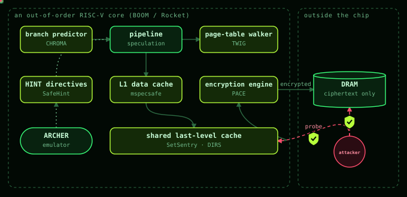

*Each piece of the thesis sits at one place a secret can leak from a RISC-V system: the predictor, the walker, the cache, the shared LLC and the memory bus. ARCHER is the emulator the attacks and defences were first tried on; the RTL work runs on BOOM and Rocket.*

**Published from the thesis**

- **[PACE: A Page-Adaptive, Cache-Anchored Memory Encryption Engine for RISC-V with Formally Verified nth-Order DPA Resistance](#pace-a-page-adaptive-cache-anchored-memory-encryption-engine-for-risc-v-with-formally-verified-nth-order-dpa-resistance)** (Chips · ESCI, DOI 10.3390/chips5030025)
- **[ARCHER: A Cycle-Accurate RISC-V Emulator for Microarchitectural Side-Channel and Memory Encryption Research](#archer-a-cycle-accurate-risc-v-emulator-for-microarchitectural-side-channel-and-memory-encryption-research)** (Computers · ESCI, Scopus Q1, DOI 10.3390/computers15080479)
- **[Novel Microarchitectural Side-Channel Attacks on Open-Source RISC-V Cores](#novel-microarchitectural-side-channel-attacks-on-open-source-risc-v-cores)** (Chips · ESCI, DOI 10.3390/chips5030029)

**The problem.** RISC-V is open, extensible and being adopted at national scale, including India's SHAKTI and VEGA programmes. It ships without the standardized security hardening that decades of commercial pressure added to x86 and ARM, and many security-relevant behaviors (PMP, LR/SC atomics, WARL registers, performance counters) are implementation-defined. The side-channel posture of real open-source RISC-V cores was therefore largely unknown.

**Why.** Three gaps motivated the work. No study had systematically characterized RISC-V-specific side channels across many real cores and confirmed them on silicon. No tool could evaluate microarchitectural defenses at cycle-level fidelity and still boot Linux and run large sweeps in reasonable time. And no open RISC-V memory encryption design combined confidentiality, integrity and gate-level, formally verified higher-order masking at a deployable cost.

**What I did.** The thesis follows a discovery, evaluation and defense arc built on open, reproducible artifacts: published open cores, the Chipyard flow, cycle-model emulation and commodity Xilinx FPGA silicon. Discovery measures 23 side-channel classes on a six-core corpus with TVLA and confidence-bounded proofs of concept, then carries them to an FPGA. Evaluation builds ARCHER, an emulator calibrated against Chipyard RTL, to reproduce known attacks and compare defenses quickly. Defense designs PACE, a memory encryption engine whose masked core is proven secure by three formal tools and realized on FPGA.

**Thesis statement.** The openness of the RISC-V instruction-set architecture makes the security of its implementations against side-channel attacks a problem that can, and therefore must, be addressed empirically and end-to-end: the architecture's distinctive features give rise to novel side channels that can be discovered and measured on real cores; those channels and their defences can be evaluated at cycle-model fidelity with open tooling; and the resulting defensive knowledge can be realised as formally verified, low-overhead hardware, closing the loop from discovery, through evaluation, to defence.

**Research questions**

- RQ1 (Discovery): Which side channels are specific to open-source RISC-V cores, how prevalent are they from in-order to wide out-of-order designs, and do they survive the move from simulation to silicon?
- RQ2 (Evaluation): Can one emulation environment model microarchitectural timing faithfully enough to reproduce known attacks and evaluate defenses, yet run fast enough for large sweeps and full OS boots?
- RQ3 (Defense): Can an in-line memory encryption engine for RISC-V provide confidentiality, integrity and formally verified nth-order power-analysis resistance at low overhead, validated on FPGA silicon?

**Contributions**

- A simulation-to-silicon characterization of 23 side-channel classes on six open RISC-V cores, six of them new primitives rooted in RISC-V-specific features.
- Eight RTL and firmware mitigations with measured area, power, portability and software cost.
- ARCHER, an open, INI-configurable cycle-level RISC-V emulator calibrated against Chipyard RTL, with seven new speculation-defense policies and the AMES memory encryption engine.
- PACE, a page-adaptive, cache-anchored memory encryption engine with confidentiality, integrity and nth-order DPA resistance, formally verified at the netlist level and realized on FPGA.
- Methodology: a three-tier novelty taxonomy, a statistical-validity treatment of TVLA with Wilson intervals, and a design checklist for RISC-V implementers.

**Key results**

- 23 side channels across 6 cores; 6 have no x86 or ARM analogue.
- PMPectre timing gap up to 126 cycles with zero architectural faults.
- 6 of 8 mitigations at no more than 0.8% LUT area; all 8 under 2 mW power change.
- ARCHER: Linux boot under 3 minutes, 3.7x faster than gem5, 9.4% mean deviation from Chipyard RTL.
- Classical Spectre-family defenses reach zero leakage at under 0.3% IPC loss.
- PACE: 9x lower writeback latency; masked core proven secure through order 3; overhead within noise for cache-resident workloads.

**The story in one minute**

- Correct silicon is not safe silicon: the ISA fixes results, but timing, caches and predictors are left to the implementer, and that gap leaks.
- RISC-V is open and spreading fast, but it has no standard side-channel hardening and several of its features are implementation-defined.
- Discovery: 23 channels measured on six open cores, six of them new. PMP, the RISC-V memory protection unit, can be bypassed speculatively.
- The channels are real: they reproduce on FPGA silicon, often stronger than in simulation, and eight small RTL fixes close them.
- Evaluation: ARCHER boots Linux in under three minutes and tests a defense in minutes instead of hours, within 9.4% of real RTL timing.
- Defense: PACE encrypts memory per page and hides the cipher's latency inside the cache, cutting writeback cost 9x.
- Its key engine is masked and proven secure by three independent formal tools, then built on an FPGA.
- Result: the security of an open ISA can be measured, reasoned about and built, at low cost.

**Chapters**

1. **Introduction.** Opens with how Meltdown and Spectre in 2018 moved trust below the software line, then explains why RISC-V's openness is both a strength and a new attack surface. It reviews microarchitectural and power side channels and why main memory sits outside the trust boundary. It states three gaps, three research questions and the thesis statement, and fixes the scope to hardware side channels on open cores.
   - Three research questions organized as discovery, evaluation and defense.
   - Scope: microarchitectural timing and power leakage on open RISC-V; invasive and fault attacks excluded.
2. **Literature Review.** Surveys cache and speculative-execution attacks, power and electromagnetic side channels, memory encryption and integrity, trusted execution, cryptographic ISAs, secure boot and fault injection. It then narrows to the RISC-V security literature. The synthesis argues the field is mature on closed x86 and ARM silicon but thin and largely unvalidated on real open RISC-V hardware.
   - Identifies Gap 1: no silicon-validated study of RISC-V-specific channels.
   - Identifies Gap 2: no evaluation tool that is both cycle-faithful and fast.
   - Identifies Gap 3: no practical, formally verified memory encryption for RISC-V.
3. **Novel Side-Channel Attacks on Open-Source RISC-V Cores.** Answers RQ1 by measuring 23 side-channel classes across Rocket, VexiiRiscv, CVA6 and three BOOM widths, plus two dual-hart SoCs. Six classes are new and come from RISC-V's own features such as PMP, WARL registers, the page-table-walker fault path and LR/SC reservations. Each channel is quantified with TVLA and Wilson confidence intervals and then confirmed on a Zedboard FPGA. Eight RTL and firmware mitigations close the channels at small measured area and power cost. Published as [Novel Microarchitectural Side-Channel Attacks on Open-Source RISC-V Cores](#novel-microarchitectural-side-channel-attacks-on-open-source-risc-v-cores).
   - 23 channels: 6 novel (Tier A), 7 first cross-privilege RISC-V instances (Tier B), 10 known classes (Tier C).
   - PMPectre: PMP-denied loads forward speculatively on out-of-order cores, timing gap up to 126 cycles, zero faults raised.
   - 84 unit-level silicon measurements and an 11-experiment whole-core battery; amplification 2.1x to 43x on silicon.
   - 6 of 8 mitigations cost at most 0.8% LUT area; all 8 change dynamic power by under 2 mW.
4. **ARCHER: A Cycle-Accurate RISC-V Emulator for Side-Channel and Memory-Encryption Research.** Answers RQ2 with ARCHER, an RV64IMAFDC emulator with pluggable in-order, out-of-order and SMT cores, coherent caches and up to 16 harts, all configured through INI files. It boots Linux 6.6 in under three minutes and is calibrated against Chipyard's fab-ready RTL. On it, ten classical attacks are reproduced and evaluated against thirteen speculation policies, seven of them new. It also hosts AMES, a bus-layer memory encryption engine that is the simulation precursor to PACE. Published as [ARCHER](#archer-a-cycle-accurate-risc-v-emulator-for-microarchitectural-side-channel-and-memory-encryption-research).
   - 3.7x faster than gem5 DerivO3CPU (geometric mean) on bare-metal microbenchmarks.
   - Mean 9.4% cycle-count deviation from Chipyard RTL at a median 88x host-throughput advantage over Verilator.
   - Every configured defense drives leakage to zero at under 0.3% IPC loss on a full Linux boot.
   - Seven new speculation-defense policies across three mechanism families.
5. **PACE: A Page-Adaptive, DPA-Resistant Memory-Encryption Engine for RISC-V.** Answers RQ3 with PACE, a TileLink engine placed between the last-level cache and memory that picks a protection policy per physical page from page-table bits. Counter-mode keystreams are precomputed while lines are cached, so evictions only XOR. Fresh re-keying and domain-oriented masking protect the engine's key against power analysis, and the masked Ascon-p S-box is proven secure by three formal tools. The engine runs on Rocket and BOOM and is placed, routed and programmed on a Xilinx XC7Z020. Published as [PACE](#pace-a-page-adaptive-cache-anchored-memory-encryption-engine-for-risc-v-with-formally-verified-nth-order-dpa-resistance).
   - Writeback latency reduced 9x (90 to 10 cycles); with integrity, 320 to 10 cycles.
   - Masked core proven order-d secure by COCO, PROLEAD and SILVER (d = 1, 2), and by COCO through d = 3.
   - Application-level overhead within measurement noise of plaintext for cache-resident workloads; masking adds no cycles.
   - Measured trace-amplification exponents 1.92/3.70/5.40/6.97 match the predicted 2(d+1) law.
6. **Conclusions and Future Work.** Revisits the three research questions and answers each one affirmatively with the evidence of Chapters 3 to 5. It states the limits plainly: results are cycle-model-relative, rest on open cores and FPGAs rather than custom tape-outs, and PACE's DPA evidence is formal and simulated because the on-chip campaign is sensitivity-limited. It sets out future work on a physical break-then-fix, silicon-anchored calibration of ARCHER, and new RISC-V extensions.
   - Future work: co-placed sensor array and 10^5 to 10^6 trace campaign for PACE.
   - Future work: extend discovery to vector, hypervisor and scalar-crypto extensions and to multi-socket coherence.
   - Future work: compose all eight mitigations on one core and measure combined cost.

## Publications

### PhD journal papers

#### PACE: A Page-Adaptive, Cache-Anchored Memory Encryption Engine for RISC-V with Formally Verified nth-Order DPA Resistance

`PhD thesis` paper

Jyotiprakash Mishra, Sanjay K. Sahay, Swati Mishra, Aman Pathak  
*Chips, Vol. 5, Issue 3, Article 25*, 2026 · ESCI · DOI [10.3390/chips5030025](https://doi.org/10.3390/chips5030025)

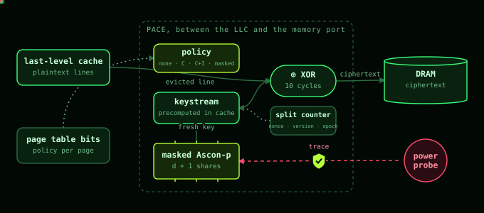

*A line leaving the cache is XORed with a keystream computed while it was still cached, so a writeback takes 10 cycles instead of 90. Each page gets its own policy, and the one block that touches the key is masked, so its power trace says nothing.*

**The problem.** Main memory sits outside the processor's trust boundary, so cold boot attacks, bus interposers and malicious DMA can read or tamper with DRAM. Commodity chips answer this with in-line memory encryption. But the encryption engine then processes one long-lived key over attacker-influenced data at a fixed location, which is exactly the setting differential power analysis (DPA) exploits. If that key is recovered, all of memory is exposed at once.

**Why I wrote it.** The open-hardware ecosystem had no memory encryption engine that is both co-designed with the cache hierarchy and hardened against side-channel analysis of the engine itself. Commercial engines (AMD SME/SEV, Intel TME/TDX, Arm CCA) are closed and do not expose or verify their side-channel posture. Integrity-tree research treats the cipher as a black box, and where masking is used it is rarely verified on the synthesized gate-level netlist under a glitch-aware model.

**What we did.** PACE is a TileLink adapter placed between the last-level cache and the memory port of a Rocket SoC built in Chipyard, written in Chisel. Per physical page it applies one of four policies (plaintext, confidentiality, confidentiality plus integrity, or additionally masking of order d), selected from RISC-V page table bits through a memory-mapped control plane programmed by the OS. Confidentiality uses counter mode, and the keystream for a line is precomputed while the line is still in the cache, so an eviction needs only an XOR. A single split counter serves as the counter-mode nonce, the anti-replay integrity version and the re-keying epoch. DPA resistance is layered: ISAP-style fresh re-keying limits each key to about one encryption (q close to 1), and domain-oriented masking with d+1 shares protects the one key-processing block, a masked Ascon-p S-box. The design was verified with three formal tools, attacked with simulated traces, and placed, routed and programmed on a Xilinx XC7Z020 FPGA with an on-chip ring-oscillator power sensor.

**What we found**

- Precomputing the keystream during cache residency cuts confidentiality-only writeback latency from 90 to 10 cycles (9x); with integrity, eviction latency falls from 320 to 10 cycles.
- The masked Ascon-p S-box is proven order-d secure under a glitch- and transition-aware model by COCO, PROLEAD and SILVER at d = 1 and 2, and by COCO through d = 3.
- Simulated-trace CPA recovers all 128 key bits from the unprotected core; with d = 1 masking, CPA falls to the random-guess rate and TVLA |t| stays near 1 (threshold 4.5) even at 8000 traces.
- Measured trace-amplification exponents of 1.92, 3.70, 5.40 and 6.97 for d = 0 to 3 track the predicted 2(d+1) law (2, 4, 6, 8).
- On in-order Rocket and out-of-order BOOM, application-level overhead is within measurement noise of plaintext for cache-resident workloads; Embench-IoT averages 2.3%, CoreMark and Dhrystone are within 0.06%, and memory-bound STREAM reaches 17%. Masking is cycle-identical to plain confidentiality.
- On the XC7Z020 the d = 2 build places and routes at 12,175 LUTs and 16,088 flip-flops with timing met at 100 MHz; the unmasked engine plus sensor is about 1.2k LUTs.

**Contributions**

- A page-adaptive, physical-address-indexed memory encryption engine for RISC-V with a memory-mapped control plane, validated in RTL on Rocket with zero-overhead bypass for plaintext pages.
- Cache-anchored keystream precompute, a new mechanism that removes the cipher from the eviction-critical path.
- A unified split counter that serves as nonce, integrity version and re-keying epoch, with tree-free Tier-A integrity and a live block-MAC Bonsai Merkle tree (Tier-B) for scale-out.
- Netlist-level formal verification of the masked core by three independent glitch-aware tools, with a careful treatment of statistical versus exact verdicts.
- An analytic side-channel model linking masking order, noise and re-keying to traces-to-disclosure, checked against simulated CPA, TVLA and a mutual-information sweep.
- An open evaluation from simulation to FPGA silicon, including dual-core sharing, a Linux control-plane driver, an SP 800-90B-monitored TRNG and a JTAG-read TVLA campaign.

**Abstract.** Main memory carries data outside the processor's trust boundary, so commodity systems-on-chip (SoCs) increasingly encrypt it; yet, in-line memory encryption engine itself becomes a differential power analysis (DPA) target whose key, if recovered, unlocks all of dynamic random-access memory (DRAM). We present PACE, a page-adaptive, cache-anchored memory encryption engine for RISC-V that makes nth-order DPA resistance practical and keeps cryptographic latency off the cache eviction critical path. PACE inserts a TileLink adapter between the last-level cache and the memory port and applies, per physical page, one of four policies (plaintext/confidentiality/confidentiality+integrity/+masking-order-d) selected from RISC-V page table bits through a memory-mapped control plane. Confidentiality uses counter mode whose per-line keystream is precomputed during cache residency; integrity is tree-free at the embedded operating point via on-chip counters and tags, with a live split counter block-MAC Bonsai Merkle tree for scale-out. DPA resistance is layered: ISAP-style fresh re-keying caps the data complexity per key at q ≈ 1, and domain-oriented masking (DOM, d + 1 shares) protects the sole key processing block to order d. We implement PACE in Chisel on a Rocket SoC (Chipyard) and evaluate it with open-source tooling. A deterministic TileLink-level harness proves ciphertext-in-memory and detects tamper/replay/splice, and the live Tier-B engine (DRAM counters and per-line message authentication codes (MACs) plus an on-chip-rooted block-MAC tree) is validated from end to end on full Rocket and BOOM SoCs and on the FPGA; the masked Ascon-p S-box is proven order-d secure (d = 1, 2) under a glitch- and transition-aware model by three independent formal tools (COCO, PROLEAD, and SILVER, the last also deciding the full composability lattice and confirming exact glitch-robust order-2 probing security), with COCO extending the exact verdict to the highest synthesized order d = 3 (secure at probing orders 1–3); a simulated trace correlation power analysis (CPA) recovers the full key from an unprotected core and is defeated by masking, with a mutual information analysis confirming the N ∝ σ^2(d+1) trace amplification law. We further realize PACE on field-programmable gate array (FPGA) silicon: the engine plus an on-chip ring oscillator power sensor is placed, routed, timing-closed at 100 MHz, and programmed on a Xilinx XC7Z020, and we drive a fixed-vs-random Test Vector Leakage Assessment (TVLA) campaign read back entirely over a JTAG (Joint Test Action Group). A multi-core configuration and a Linux control-plane driver are likewise validated. Across synthetic access patterns and named application kernels (AES, SHA-256, matrix multiplication, pointer chasing) on both in-order Rocket and out-of-order BOOM, application-level overhead is within measurement noise of plaintext for cache resident workloads (masking, in particular, is cycle-identical to plain confidentiality), and we characterize the cost of each policy, masking order, and re-keying interval, demonstrating side-channel-hardened memory encryption on open RISC-V hardware.

*Keywords: memory encryption, side-channel analysis, differential power analysis, masking, domain-oriented masking, RISC-V, Rocket, Chipyard, Ascon, ISAP, counter mode, memory integrity, Bonsai Merkle tree, leakage-resilient cryptography*

#### ARCHER: A Cycle-Accurate RISC-V Emulator for Microarchitectural Side-Channel and Memory Encryption Research

`PhD thesis` paper

Jyotiprakash Mishra, Sanjay K. Sahay, Swati Mishra, Aman Pathak  
*Computers, Vol. 15, Issue 8, Article 479*, 2026 · ESCI, Scopus Q1 · DOI [10.3390/computers15080479](https://doi.org/10.3390/computers15080479)

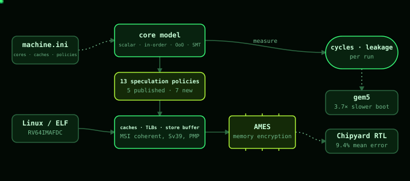

*One INI file describes the machine; ARCHER boots Linux on it in under three minutes and reports cycles and leakage, and every parameter is set at run time. Its timing was checked against gem5 and against Chipyard RTL.*

**The problem.** Side-channel attacks such as Spectre, Meltdown and MDS leak data through caches, branch predictors, store buffers and speculative execution. Testing a defense against them needs a simulator that reproduces those timing effects, not only correct results. Fast functional tools (Spike, QEMU) model no caches or speculation, while gem5's detailed out-of-order model needs hours to boot Linux and has a 300,000+ line C++ codebase.

**Why I wrote it.** No available tool combined the microarchitectural fidelity side-channel research needs, full operating-system boots in minutes, and a codebase simple enough to add new defenses quickly. Earlier defense studies each needed a separate gem5 fork with 2000 to 5000 lines of custom C++. The thesis needed large attack-by-defense sweeps, which was not practical with existing tools.

**What we did.** ARCHER is an RV64IMAFDC emulator written in C with four pluggable core types (scalar, in-order pipeline, superscalar out-of-order, SMT), 1 to 16 harts, MSI-coherent caches, store and fill buffers, and the full M/S/U privilege architecture with Sv39 and PMP. Every microarchitectural parameter is set at runtime from INI files, so design-space sweeps need no recompilation. It ships thirteen speculation policies: an unrestricted baseline, five published defenses (InvisiSpec, Delay, STT, CleanupSpec, Fence) and seven new ones in three mechanism families. Its cycle model was checked against gem5 and against Chipyard's Verilator-simulated Rocket and BOOM RTL. A bus-layer engine, AMES, adds authenticated memory encryption with four ciphers and per-leaf mask-XOR hardening against power analysis.

**What we found**

- Boots Linux 6.6 with OpenSBI in under three minutes and runs 3.7x faster (geometric mean) than gem5's DerivO3CPU on head-to-head bare-metal microbenchmarks.
- Matches Chipyard's fab-ready Rocket and BOOM RTL to a mean 9.4% (median 9.1%) cycle-count deviation across a 20-cell workload-by-core matrix, at a median 88x host-throughput advantage over Verilator.
- Produces bit-identical architectural output to QEMU.
- Reproduces ten attacks (Spectre v1/v2/RSB/BHB, Meltdown-US, L1TF, Fallout, RIDL, prefetch and SMT channels); the classical defenses drive leakage from 100% to 0% at under 0.3% IPC loss on a full Linux boot.
- Of the seven new policies, AKTO, CRPSO and LFBCO close all five classical Spectre variants, PSF closes four and DLRF two; ROPC and MDPO close the RSB and AES T-table cache-timing cases they target.
- AMES runs 924 parameter-shape points with zero integrity failures; mask-XOR moves first-order CPA from full-key recovery at 1000 traces to no recovery at 100,000 traces for any d >= 1.

**Contributions**

- A cycle-accurate RV64IMAFDC emulator with pluggable core types, coherent caches and full privilege architecture, configured at runtime through INI files.
- End-to-end reproduction of ten microarchitectural attacks across fifteen defense configurations on Linux 6.6, with statistical evidence of leakage and suppression.
- Seven new speculation-defense policies (AKTO, CRPSO, DLRF, LFBCO, MDPO, PSF, ROPC) across issue-gate, predictive-redirect and selective-cleanup families.
- Calibration against Chipyard RTL for Rocket and BOOM, and family-level Flush+Reload fidelity across four Chipyard configurations (HIT peaks within one cycle on every cell).
- AMES, a bus-layer memory encryption engine with AES-128-GCM, ASCON-128, PRINCE-64 and QARMA-64 (each checked by known-answer tests), a hierarchical key tree and configurable integrity-tree arity.
- A public reproducibility artifact (sources, configs, workloads, per-figure scripts) under the MIT license.

**Abstract.** Microarchitectural side-channels leak data through caches, branch predictors, store buffers, and speculative execution. Evaluating defenses at cycle-model fidelity has forced a choice between functional tools (Spike, QEMU) and gem5's hours-long Linux boots. ARCHER is a cycle-model-relative RV64IMAFDC RISC-V emulator with pluggable superscalar out-of-order execution, coherent caches, simultaneous multithreading, 1 to 16 harts, and thirteen speculation policies: an unrestricted baseline plus five classical defenses and seven new defenses spanning issue-gate, predictive-redirect, and selective-cleanup mechanism families. It boots Linux 6.6 in under three minutes, runs 3.7× faster (geometric mean) than gem5's DerivO3CPU on head-to-head bare-metal microbench, matches gem5 within ±20% on 4 of 10 workloads, matches Chipyard's fab-ready RTL to a 9.4% mean cycle-count deviation under two fitted match-configurations, and produces bit-identical architectural output to QEMU at a median 88× host-throughput advantage over Chipyard's Verilator flow. Every published Spectre-family defense drives leakage to zero at sub-0.3% instructions-per-cycle (IPC) loss on a full Linux boot, and each new policy is validated on the attack surface its mechanism defends. The Adaptive Memory Encryption Scheme (AMES) adds a bus-layer engine with four authenticated ciphers (each validated bit-exact against its published specification) and per-leaf mask-XOR for Differential Power Analysis (DPA) hardening; a first-order Correlation Power Analysis consistency check confirms the direction of the theoretical bound under the shipped leakage model. Together, ARCHER and AMES provide a single INI-configurable environment for cycle-model side-channel evaluation in minutes rather than hours.

*Keywords: RISC-V, cycle-accurate emulation, side-channel attacks, Spectre, Meltdown, memory encryption, microarchitectural security, cache timing, differential power analysis, Chipyard, Rocket, BOOM*

#### Novel Microarchitectural Side-Channel Attacks on Open-Source RISC-V Cores

`PhD thesis` paper

Jyotiprakash Mishra, Sanjay K. Sahay, Swati Mishra, Aman Pathak  
*Chips, Vol. 5, Issue 3, Article 29*, 2026 · ESCI · DOI [10.3390/chips5030029](https://doi.org/10.3390/chips5030029)

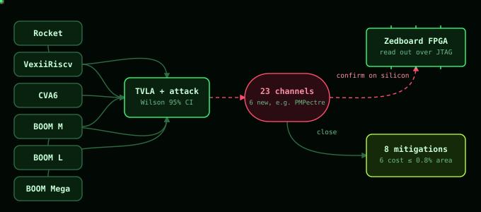

*Six cores from one flow differ in only a few structures, so each leak can be blamed on one of them. Every channel is measured, proved with an attack, run on an FPGA, and then closed.*

**The problem.** RISC-V is now in commercial SoCs, accelerators and embedded controllers, but it has features with no x86 or ARM counterpart: Physical Memory Protection (PMP), write-any-read-legal (WARL) configuration registers, LR/SC atomic reservations and the open TileLink coherence fabric. Their side-channel behavior had not been audited. Open cores also make their own microarchitectural choices, each a possible leak.

**Why I wrote it.** Most earlier RISC-V side-channel work reproduced known x86 attacks on an open core instead of asking whether RISC-V's own features create new channels. No prior study measured a broad corpus of open cores, from in-order to wide out-of-order, on one footing, and few carried results from noise-free RTL simulation to real silicon, where jitter and contention might hide a channel. Mitigations were also rarely costed in silicon area and power.

**What we did.** The study uses six open cores built through one Chipyard flow: Rocket, VexiiRiscv, CVA6, and BOOM at three widths (Medium, Large, Mega), plus two dual-hart SoCs for cross-hart channels. Because adjacent cores differ in few structures, each channel can be attributed to a specific microarchitectural cause. Every channel is measured with Welch's TVLA and paired with a proof of concept whose success rate carries a Wilson 95% confidence interval. Attack units and a whole RocketTile were then run on a Xilinx Zedboard (xc7z020), read out through a program-counter-encoding channel over JTAG. Eight mitigations were implemented in RTL and firmware and measured for closure, portability, adaptive-attacker resistance, software overhead, area and power.

**What we found**

- 23 attack classes characterized: 6 novel RISC-V-specific primitives (Tier A), 7 cross-privilege and coherence channels first shown on RISC-V (Tier B), and 10 known classes given their first systematic multi-core RISC-V treatment (Tier C).
- PMPectre (NV4): on out-of-order cores a PMP-denied load forwards data speculatively before the check retires, with a timing gap up to 126 cycles on LargeBoom and zero architectural faults raised.
- A single unprivileged WARL write-and-read-back of PMP registers fingerprints the core family, and the PTW/PMP fault cause splits BOOM (cause 1) from Rocket, VexiiRiscv and CVA6 (cause 5).
- Key recovery up to 64/64 on several channels, including page-walk-cache and predictor-residue channels; four distinct integer divider designs leak the same secret at different granularities.
- On silicon: 84 live unit-level measurements and an 11-experiment battery on a whole RocketTile, with channel amplification from 2.1x to 43x relative to simulation.
- Six of the eight mitigations cost at most 0.8% LUT area and all eight change dynamic power by under 2 mW; the larger cases are constant-time divide (+1.0%) and translation walk-flush (+16.4%).

**Contributions**

- Six novel RISC-V-specific channels: the PMPectre family, PMP WARL fingerprinting, PTW/PMP fault-cause fingerprinting, and LR/SC reservation lifetime and granularity channels.
- Seven cross-privilege and coherence channels first instantiated on RISC-V, including a TileLink MESI covert channel with AES key recovery and machine-to-supervisor predictor residue.
- Ten known-class channels characterized across the corpus and confirmed on silicon, including non-constant-time dividers in CVA6 and BOOM.
- Silicon validation on a Zedboard with whole-core versus unit cross-validation and a 23-build synthesis and power characterization.
- Eight mitigations with a full cost model covering closure, portability, adaptive attackers, software overhead, area and power.
- A formal threat-model taxonomy, a statistical-validity treatment of TVLA, and a design checklist for RISC-V implementers.

**Abstract.** We present a simulation-to-silicon security characterization of microarchitectural side channels on open-source RISC-V cores. Twenty-three attack classes are measured across a six-core corpus that spans the design space from simple in-order pipelines (Rocket, VexiiRiscv) through a single-issue in-order core (CVA6) to a three-point out-of-order width sweep (BOOM Medium/Large/Mega), together with two dual-hart systems-on-chip for cross-hart channels. Six of the classes are novel microarchitectural primitives rooted in RISC-V-specific features that lack x86/ARM counterparts: speculative and enforcement-timing leakage through Physical Memory Protection (PMP), PMP write-any-read-legal (WARL) fingerprinting, page-table-walker/PMP fault-cause fingerprinting, and load-reserved/store-conditional (LR/SC) reservation lifetime and granularity channels, while the remainder are the first systematic cross-privilege and cross-core RISC-V instantiations of coherence, predictor, translation, and functional-unit channels. Every channel is quantified with Welch's Test Vector Leakage Assessment (TVLA) and paired with a proof of concept whose success rate is reported with Wilson 95% confidence intervals and explicit sample counts. Critically, we move the evaluation beyond deterministic register-transfer-level (RTL) simulation to real silicon: on a Xilinx Zedboard (xc7z020), we capture eighty-four live unit-level channel measurements and run an eleven-experiment side-channel battery on a whole RISC-V core, with a synthesis and dynamic-power model for every attack unit. Eight mitigations are implemented at the RTL and firmware levels; each is evaluated for channel closure (TVLA), portability across cores, robustness to an adaptive attacker, amortized software overhead on a standard workload suite, and, for the first time in this setting, measured silicon area and dynamic-power cost. Six of the eight mitigations cost at most 0.8% look-up-table area, and all eight change dynamic power by under two milliwatts. We further contribute a formal threat-model taxonomy, a statistical-validity treatment of the TVLA methodology, and a design-recommendation checklist for RISC-V implementers.

*Keywords: hardware security, microarchitectural side channels, RISC-V, physical memory protection, PMPectre, speculative execution, transient execution, TileLink coherence, branch predictor, FPGA silicon validation, test vector leakage assessment, constant-time mitigation*

### Published

#### Formal Verification of Software-Managed Cache Coherency for RISC-V Heterogeneous Embedded Systems

Jyotiprakash Mishra, Sanjay K. Sahay, Swati Mishra, Aman Pathak  
*Smart Trends in Computing and Communications (SmartCom), Lecture Notes in Networks and Systems, Vol. 1997, Springer, pp. 430-442*, 2026 · Scopus · DOI [10.1007/978-3-032-27563-9_40](https://doi.org/10.1007/978-3-032-27563-9_40)

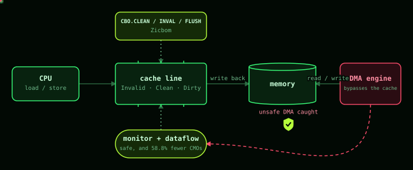

*When a DMA engine bypasses the cache, the program must clean or invalidate lines at exactly the right moments. The paper proves when that is safe, then removes the cache maintenance that is not needed: 58.8% fewer operations on six benchmarks.*

**The problem.** Many embedded chips use DMA engines that bypass the CPU caches, so software must issue cache management operations (CMOs) by hand. The RISC-V Zicbom extension provides CBO.CLEAN, CBO.INVAL and CBO.FLUSH for this. A missing CMO causes stale reads or lost writes that silently corrupt data. Flushing before every DMA transfer is safe but slow in latency-sensitive code such as audio, sensor fusion and accelerator offload.

**Why I wrote it.** CMO placement was guided by informal rules and manual reasoning. Hardware coherence protocols such as MESI do not apply to non-coherent DMA, and memory-model verification tools target thread-to-thread synchronization, not CPU-to-device coherency. The paper fills this gap with a formal treatment that says exactly which CMOs are required.

**What we did.** The system is modeled as a transition system with per-line cache states Invalid, Clean and Dirty, CPU loads and stores, the three Zicbom CMOs, and DMA reads and writes that bypass the cache. The paper proves necessary and sufficient preconditions for a safe DMA write (every cached copy invalid) and a safe DMA read (no dirty copy). It builds a coherency monitor automaton, proves that verification is decidable for bounded programs, and proves a compositionality result that lets addresses be checked independently. A forward and backward dataflow analysis then removes redundant CMOs and downgrades FLUSH to CLEAN or INVAL where possible. The model and optimizer were implemented in about 2,500 lines of Python and run on six embedded DMA benchmarks.

**What we found**

- Across six benchmarks the optimizer cut CMOs from 1,232 to 508, a 58.8% reduction, and every optimized program was verified coherent.
- Reduction ranged from 25.0% (double buffering) to 83.3% (accelerator offload); producer-consumer reached 70.8%.
- Estimated cycle cost of CMOs fell by 26.6% on average and by up to 57.6% (accelerator offload), using 50/10/60-cycle costs for CLEAN/INVAL/FLUSH.
- Minimal CMO choice is proved: INVAL before a DMA write, CLEAN before a DMA read; FLUSH is never minimal.
- Verification is decidable in O(3^(|P|x|A|) x |pi|) time for bounded programs, and address partitioning reduces this to O(k x 3^(|P|x n/k)).
- The optimizer runs in time linear in program size, O(|pi| x |P| x |A|); the full benchmark suite ran in about 53 seconds.

**Contributions**

- An automata-based formal model of software-managed cache coherency for RISC-V with Zicbom and non-coherent DMA.
- Necessary and sufficient conditions for safe DMA writes and reads (Theorems 1 and 2) and the minimal CMO for each case.
- A coherency monitor automaton with a proof that coherency verification is decidable for bounded programs.
- A compositionality theorem that allows verification address by address.
- A sound dataflow algorithm that removes redundant CMOs, evaluated on six embedded DMA benchmarks.

**Abstract.** Modern embedded systems increasingly rely on non-coherent DMA to reduce hardware complexity, requiring explicit software management of cache coherency through Cache Management Operations (CMOs). We present a formal automata-based model for software-managed cache coherency in RISC-V systems with the Zicbom extension. Our model precisely characterizes the necessary and sufficient conditions for safe DMA operations, proves that coherency verification is decidable for bounded programs, and provides a sound dataflow-based algorithm for eliminating redundant CMOs. Evaluation on six embedded benchmarks demonstrates 58.8% average CMO reduction with verified coherency maintenance.

*Keywords: Cache coherency, RISC-V, DMA, Formal verification, Automata, Embedded systems, Zicbom*

#### RV-JOSH: A Hardened Operating System for RISC-V based on Java

Jyotiprakash Mishra, Sanjay K. Sahay, Swati Mishra, Aman Pathak  
*Smart Trends in Computing and Communications (SmartCom), Lecture Notes in Networks and Systems, Vol. 1991, Springer, pp. 390-401*, 2026 · Scopus · DOI [10.1007/978-3-032-27754-1_36](https://doi.org/10.1007/978-3-032-27754-1_36)

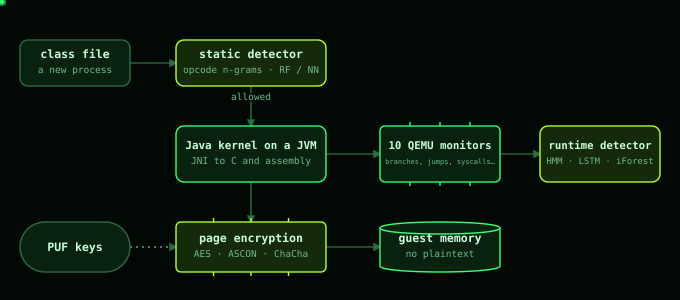

*An operating system whose kernel is Java, on bare-metal RISC-V. Every program is checked twice for malware, once from its bytecode and once from how it runs, and its pages are encrypted with keys from a PUF.*

**The problem.** RISC-V is spreading into IoT and embedded devices, but those platforms need protection against malware and against memory attacks such as power analysis on encryption keys. Operating system kernels are written in C and assembly, which makes them hard for new developers to change and open to memory-safety bugs. Security features also have to be wired into large, tightly coupled code bases such as Linux.

**Why I wrote it.** The paper cites the difficulty of evolving Linux, including the rejection of RISC-V changes for Linux 6.17 over code quality and the Rust-for-Linux maintainer resignations. Earlier Java operating systems such as JNode and JX showed the idea is feasible but have been dormant for a decade and offer no malware detection or memory encryption for RISC-V. User-space malware detectors can add delays above 100 ms, which leaves room for evasion.

**What we did.** RV-JOSH runs a JVM on bare-metal RISC-V, with the kernel written in Java and calling a thin C and assembly layer through JNI; Java class files load directly as OS processes. A static detector scans bytecode at process creation, extracts 1-gram and 2-gram opcode features and classifies them with a random forest and a neural network. A runtime detector samples ten new QEMU performance monitors (basic-block size, branch density, memory access pattern, instruction mix, code-page writes, syscall frequency, jump targets, hot paths, memory span, NOP runs) and feeds HMM, LSTM and Isolation Forest models. A page-level memory encryption module supports AES-256, ASCON-128a and ChaCha20-Poly1305 with PUF-derived keys, constant-time code against SPA and periodic rekeying against first-order DPA. QEMU was also extended with an encrypted page cache so plaintext never appears in guest memory.

**What we found**

- Kernel boot takes 22-38 ms on qemu-system-riscv64 10.0.2; JVM initialization (8-12 ms) and crypto engine setup (5-8 ms) dominate.
- Software encryption throughput without rekeying: ChaCha20 798.5 MB/s, ASCON-128 402.8 MB/s, AES-128 151.2 MB/s.
- Rekeying every 5 operations lowers ChaCha20 read throughput to 656.1 MB/s; rekeying every 100 operations keeps it at 783.6 MB/s.
- Static detection latency: neural network 0.263 ms per sample (3,793 samples/s); random forest with 128 trees 39.3 ms (25 samples/s).
- Dynamic detection latency: LSTM 0.81 ms, HMM 0.788 ms, Isolation Forest 10.5 ms per sample.
- Models were evaluated on synthetic data (10,000 static samples with 256 features; 50,000 dynamic samples with 10 counter features), since no real Java malware dataset for RISC-V exists.

**Contributions**

- A RISC-V operating system with a Java kernel and minimal C and assembly, where Java classes load directly as processes.
- A hybrid malware detection framework combining static bytecode n-gram analysis with runtime hardware-counter monitoring.
- Ten additional QEMU performance monitors for behavioral malware analysis.
- A page-level memory encryption module with selective encryption and configurable rekeying, designed to resist SPA and DPA on IoT-class devices.

**Abstract.** RISC-V's open architecture has gained wide adoption, but ensuring platform security remains challenging. We present a RISC-V operating system with a Java-based kernel using JNI for low-level services. User processes written in Java can be directly loaded as OS processes, lowering development barriers. The system includes malware detection combining static bytecode analysis with runtime monitoring. Static analysis extracts n-gram opcode features classified using random forest and neural network models. Runtime detection uses extended hardware performance counters via QEMU augmentation. A page-level memory encryption module provides resistance to Simple and Differential Power Analysis using selective encryption and periodic rekeying for IoT device constraints. The result is a RISC-V platform combining accessible OS development with multi-layered protection.

*Keywords: Security, Operating Systems, RISC-V, Java, Memory Encryption, Malware Detection, QEMU*

#### Duplicates in the Drebin Dataset and Reduction in the Accuracy of the Malware Detection Models

Jyotiprakash Mishra, Sanjay K. Sahay, Hemant Rathore, Lokesh Kumar  
*26th IEEE Asia-Pacific Conference on Communications (APCC 2021), IEEE, pp. 161-165*, 2021 · CORE C; IEEE Xplore; DBLP · DOI [10.1109/apcc49754.2021.9609892](https://doi.org/10.1109/apcc49754.2021.9609892)

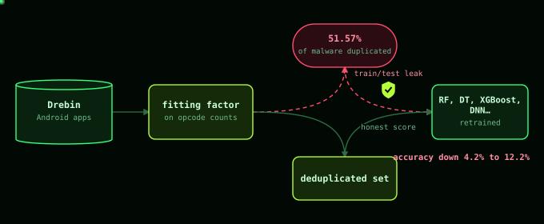

*Half the malicious samples in Drebin had near-copies. Left in, the copies leak between training and testing and make detectors look better than they are; taken out, accuracy fell by 4.2% to 12.2%.*

**The problem.** Drebin is one of the most used Android malware datasets for training and comparing machine-learning detectors. If many malicious samples are copies of each other, the same app can appear in both training and test sets. Reported accuracy then measures memorization rather than detection of new malware.

**Why I wrote it.** A frequency table of Dalvik opcodes in Drebin suggested an unusually large number of near-identical malicious files. Many published detectors reported high accuracy on Drebin without checking for this. The authors wanted to measure how many duplicates exist and how much they distort the reported results.

**What we did.** The authors used a fitting factor measure on opcode occurrence to find duplicate malicious files in Drebin. They then trained popular detectors with and without the duplicates, using all features, the top 26 features selected by Information Gain, and 26 features learned by an Auto-Encoder. Classifiers tested were Random Forest, Decision Tree, Bagging, Gradient Boost, XGBoost and a Deep Neural Network.

**What we found**

- 51.57% of malicious samples in Drebin have one or more duplicates.
- Random Forest accuracy drops by 4.2% with all features, 5.3% with the top 26 IG features and 8.8% with the AE features once duplicates are removed.
- The largest drop, 12.2%, is for the Deep Neural Network with IG-selected features.
- Conclusion: earlier reported Drebin-based detection accuracy is exaggerated and may mislead the field.
- Cited 11 times on Google Scholar (10 on OpenAlex) as of October 2026.

**Contributions**

- Quantified duplication among Drebin malware samples using opcode-based fitting factor.
- Measured the accuracy loss of six classical and deep classifiers after deduplication.
- Compared the effect across three feature sets: all features, Information Gain and Auto-Encoder.
- Raised a dataset-hygiene warning for Android malware detection research.

**Abstract.** The Android operating system has constantly remained in the limelight, hence attracts the attention of cyber-criminals. Understanding the rising challenges, many researchers have bagged achievements by applying machine/deep learning techniques for the construction of malware detection models based on popular Drebin malware datasets. However, a cursory look at a table of the frequency of Dalvik opcodes leads us to believe that this dataset may have a massive number of duplicate malicious files. Hence, we used a technique called fitting factor to find the duplicate malicious files in the Drebin datasets on the basis of opcodes occurrence. We found that 51.57% malicious samples in the datasets have one or more duplicates. Hence, accordingly, we studied the performance of the popular detection models with and without duplicates with all the features, top 26 features engineered by Information Gain (IG) and Auto-Encoder (AE). The experimental results show that one of the most popular classical classifiers, the Random Forest classifier, shows a decline in accuracy by 4.2%, 5.3% and 8.8% with all features, top 26 features obtained by IG and AE respectively. To establish the observed facts we further extensively experimented with Decision Tree, Bagging, Gradient Boost, XG Boost, and Deep Neural Network. The most significant decline (12.2%) in accuracy was observed in the Deep Neural Network classifier with the features obtained by IG, i.e., the earlier reported performance of the malware detection models based on Drebin data is exaggerated, and consequently it may lead to a wrong direction in this field of research.

*Keywords: Android malware, Drebin, Duplicate samples, Dalvik opcodes, Machine learning, Deep learning, Malware detection*

#### A Hardware Security Review of RISC-V

Jyotiprakash Mishra, Sanjay K. Sahay, Aman Pathak  
*ICT Systems and Sustainability (ICT4SD 2025), Lecture Notes in Networks and Systems, Springer, Vol. 2 of the proceedings, pp. 409-422*, 2025 · Scopus · DOI [10.1007/978-3-032-06665-7_38](https://doi.org/10.1007/978-3-032-06665-7_38)

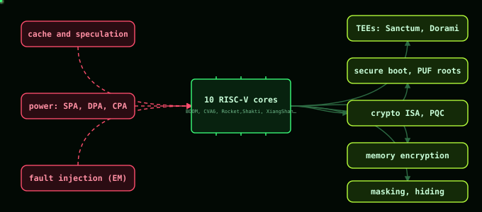

*Ten real RISC-V implementations, seven areas of attack, and what the open ecosystem already has against each.*

**The problem.** RISC-V is an open, modular ISA now used from microcontrollers to data-center chips, and national programs in China (XiangShan) and India (SHAKTI, DIR-V) are investing in it. Its openness lets attackers study the design files, and it lacks standard security features that ARM and x86 have, such as a widely accepted TEE like TrustZone or SGX. This is a risk for finance, defense, medical and other security-critical uses.

**Why I wrote it.** Side-channel, speculative and fault attacks were studied mostly on x86 and ARM, and their effect on RISC-V's modular design needed separate study. The RISC-V security work was spread across many papers on different cores and extensions. The authors wanted one review that maps known RISC-V vulnerabilities to proposed countermeasures, as a base for building secure RISC-V systems.

**What we did.** The review first surveys ten implementations: BOOM, CVA6, Shakti, StarFive VisionFive, SiFive processors, Rocket, PicoRV32, XiangShan, T-Head TH1520 and NEORV32. It then covers seven attack areas and their mitigations on RISC-V: cache and speculative side channels, power side channels (SPA, DPA, CPA), trusted execution environments (Sanctum, SMARTS, Dorami), secure boot and root of trust with PUFs, cryptographic ISA extensions including scalar AES and post-quantum accelerators, memory encryption, and electromagnetic fault injection.

**What we found**

- Surveys ten RISC-V implementations and seven attack-and-mitigation areas.
- Notes that EMFI susceptibility rises at lower supply voltage and higher clock frequency, which makes fast RISC-V designs more exposed.
- Reports a trace-verifier CFI defense against EMFI with 13.6% area, 3.5% memory and 9% power overhead.
- Finds that RISC-V memory-encryption work is mostly FPGA-based and limited to single cores such as RocketChip, with little security analysis.
- Concludes that the lack of standardized hardware security features in RISC-V remains a persistent risk, especially for IoT and low-power devices.

**Contributions**

- An overview of open-source and commercial RISC-V implementations relevant to security research.
- A RISC-V specific map of attacks and mitigations across seven areas.
- Identification of gaps, including the absence of a standard TEE and limited memory-encryption studies.
- A starting point for researchers building secure RISC-V designs.

**Abstract.** RISC-V is an open-source Instruction Set Architecture (ISA) designed with a modular and extensible structure, allowing for customizable implementations. Its simplified base ISA, combined with optional standard and custom extensions, provides flexibility for a wide range of computing applications, from embedded systems to high-performance computing. Its open design accelerates innovation and customization but also introduces security challenges by exposing the architecture to potential attacks. While RISC-V offers significant advantages, its lack of standardized security features compared to proprietary ISAs like ARM and x86 highlights persistent risks, particularly in security-critical applications. For this reason, scrutiny of RISC-V's security is crucial due to its widespread use in academia and its adoption by countries like China and India, who are looking to benefit from its open nature. We review the current security challenges in RISC-V, examining key vulnerabilities that exist in areas such as the microarchitecture, trusted execution environments, secure enclaves, secure boot, cryptographic instruction set architectures, memory encryption, and electromagnetic fault injection attacks. This review aims to cater to the needs of modern researchers for the development and implementation of the RISC-V ISA in a secure manner.

*Keywords: RISC-V, Hardware Security, Side-Channel Attacks, Speculative Execution*

#### Cache and Speculative Side Channel Attacks: A Comprehensive Review

Jyotiprakash Mishra, Sanjay K. Sahay, Aman Pathak  
*ICT Systems and Sustainability (ICT4SD 2025), Lecture Notes in Networks and Systems, Springer, Vol. 2 of the proceedings, pp. 219-233*, 2025 · Scopus · DOI [10.1007/978-3-032-06665-7_21](https://doi.org/10.1007/978-3-032-06665-7_21)

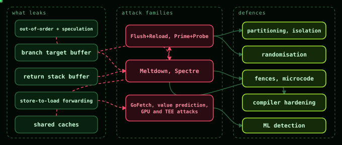

*The review starts from the hardware features that leak, groups the attacks into families, and maps each family to the defences that answer it.*

**The problem.** Speculative execution, branch prediction, prefetching and shared caches make processors fast but leave measurable traces of secret data. Since Spectre and Meltdown, almost every microarchitectural structure has been turned into a leak. Vendors shipped patches quickly, but these cost performance and did not remove the root causes; KPTI alone costs about 5% on average and up to 30% in the worst case.

**Why I wrote it.** The attack literature grew fast and spread across x86, ARM, Apple Silicon and GPUs, with new vectors such as data memory-dependent prefetchers, load value prediction and GPU compression channels. Researchers and architects needed one place that explains the mechanisms, where each attack works, and why existing mitigations fall short, so that the next defenses can be both secure and cheap.

**What we did.** The review first explains the hardware features that leak: out-of-order and speculative execution, the branch target buffer, the return stack buffer, store-to-load forwarding and deferred page-permission checks. It then classifies attacks into classical access-based attacks (Flush+Reload, Prime+Probe, Flush+Flush, CacheBleed), the Meltdown and Spectre families and newer variants: EFLAGS-based timing, load address and load value prediction (Apple Silicon), post-barrier Spectre, cross-cache kernel heap exploits, branch target injection, the GoFetch data memory-dependent prefetcher, GPU compression channels, cross-VM, browser and TEE attacks. Mitigations are grouped into partitioning and isolation, randomization, speculative fences and microcode, compiler hardening, ML-based runtime detection and timer obfuscation, followed by OS and vendor patches such as KASLR, KPTI, retpoline, Foreshadow and MDS fixes, and browser timer changes.

**What we found**

- Organizes the field into 16 attack classes, from classical cache timing to GPU compression and TEE-focused attacks.
- Groups defenses into six mitigation patterns and six families of OS and vendor patches.
- Finds that most deployed mitigations carry a performance cost and do not fully close the underlying channels.
- Identifies directions for future work: architectural isolation of critical contexts, dynamic detection, formal verification of security-critical CPU parts, and cross-layer collaboration.

**Contributions**

- An architecture-agnostic survey tracing attacks from Spectre to recent Apple Silicon attacks.
- A description of the microarchitectural features that each attack class exploits.
- A taxonomy of mitigation patterns across operating systems, hardware and compilers, with their limitations.
- A reference for hardware researchers designing defenses with low performance overhead.

**Abstract.** Modern processors have achieved significant performance enhancements through the implementation of speculative execution. These enhancements stem from hardware optimizations that not only improve performance but also introduce side channels, which are exploited to undermine the system's security model. Following the discovery of Spectre, which revealed that speculative execution pipelines could bypass security boundaries, nearly all microarchitectural structures and hardware optimizations have become targets for exploitation. In the wake of these attacks, the immediate response from organizations releasing mitigation patches led to noticeable performance degradation overnight, without fully addressing the underlying issues. This paper provides a comprehensive review of architecture-agnostic attacks on modern computing systems, tracing their evolution from the initial emergence of Spectre to contemporary attacks targeting Apple Silicon. We detail the mechanisms of these attacks, the environments in which they are exploited, and their broader security implications. Furthermore, we analyze various mitigation strategies that have been proposed, acknowledging that these strategies often fail to fully resolve the issues and typically incur a performance cost. These mitigation patterns include proposed changes in operating systems, hardware, and compilers. This review aims to provide researchers and architects with the foundational knowledge needed to develop more effective mitigation strategies that address the vulnerabilities while minimizing performance overhead.

*Keywords: Cache side-channel, Speculative execution, Microarchitectural vulnerabilities, Security*

### Accepted

#### History Is the Channel: Why Index Coloring Cannot Isolate a History-Based Branch Predictor, and a Warm Per-Domain Fix on Open RISC-V RTL

Jyotiprakash Mishra, Sanjay K. Sahay, Swati Mishra, Lalit K. Vashishtha, Aman Pathak  
*14th IEEE International Conference on Intelligent Systems and Embedded Design (ISED 2026), NIT Warangal, Telangana, India, 18-20 December 2026*, 2026 · Scopus (IEEE conference proceedings)

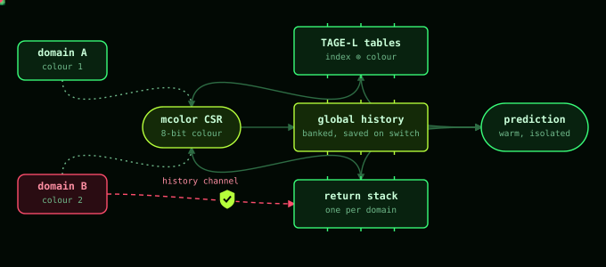

*Colouring the table index alone still lets one domain read the other through the global history. CHROMA keys the index, the history and the return stack to a domain colour, and saves each domain's history on a switch so it comes back warm.*

**The problem.** Branch predictors are shared between security domains, which enables BranchScope, Spectre-v2 branch-target injection, return-stack poisoning and branch history injection. The common low-cost defense, shipping in Arm silicon (SCXTNUM with FEAT_CSV2) and proposed in STBPU, XOR-BP, HyBP and Half&Half, folds a domain identifier into the predictor index. In a TAGE-style predictor the index depends on both the PC and the shared global history, so isolating the index does not isolate the history.

**Why I wrote it.** Almost all secure-predictor designs isolate the tables but leave the global history register and the return-address stack shared. Deployed history mitigations (Intel BHI_DIS_S, Arm ECBHB, the Linux history-clear loop) clear history at each domain boundary and pay a re-warm cost. No prior design kept a warm, per-domain history, and the residual history channel under index coloring had not been measured on open RTL.

**What we did.** On a BOOM v4 core with a TAGE-L predictor, the authors reimplement index coloring and show a history covert channel that survives it. CHROMA adds one software-set 8-bit domain color CSR, mcolor, that drives three mechanisms: a colored table index, a banked global history register saved and restored on a switch so each domain stays warm, and a per-domain return-address stack. XOR coloring (capacity preserving, probabilistic) is compared with partition coloring (deterministic, 1/N capacity). Results come from synthesizable BOOM RTL under Verilator and a TAGE-L behavioral model cross-validated against the RTL.

**What we found**

- A history covert channel stays at 100% accuracy under index coloring; CHROMA reduces it to 53% (chance).
- The cross-domain return-stack channel falls from 85% to 0%.
- At domain switches every 32 branches, clearing history causes 358% more mispredictions than warm history (4.6x the rate); the gap is 206% at 64, 120% at 128 and at most 6% from 512 branches.
- Single-domain misprediction is unchanged at 1.73% with XOR coloring; partition coloring costs 5.56% at N=4.
- On BOOM RTL with index coloring active, a victim still mispredicts 1.25% in the first 16 branches after a switch against 0% at steady state.
- Hardware cost is one 8-bit register, a 26-gate color hash and small per-domain banks; single-domain execution is bit-identical to the unmodified core.

**Contributions**

- An open-RTL measurement showing that index coloring leaves a history-based cross-domain channel open.
- A banked, warm per-domain global history that closes the channel without the re-warm cost of clearing.
- Per-domain return-address-stack isolation under the same color.
- A completeness map of which predictor substructures prior defenses isolate, and a characterization of the XOR versus partition coloring trade.
- A synthesizable BOOM artifact and a cross-validated behavioral model that reproduce every number.

**Abstract.** Cross-domain interference in the branch predictor is the substrate for a family of attacks that includes BranchScope, Spectre-v2 branch-target injection, and return-stack poisoning. The standard low-cost defense, shipping in Arm silicon (SCXTNUM with FEAT_CSV2) and proposed several times in the literature (STBPU, XOR-BP, HyBP, Half&Half), folds a software-set domain identifier into the predictor index so that different domains map to different table entries without flushing. We show on open RISC-V RTL, a BOOM out-of-order core with a TAGE-L predictor, that index coloring alone is not sufficient. Because a TAGE index is a function of both the program counter and the shared global history register, a colored-index predictor still leaks across domains through the history. In our measurements a history covert channel remains at 100% accuracy under index coloring and falls to chance only once the history itself is isolated. We present CHROMA, a single software-set domain color (mcolor, a new RISC-V control and status register) that isolates the full branch prediction unit: the table index, a per-domain global-history register kept warm across switches, and a per-domain return-address stack. Every deployed history mitigation (Intel BHI_DIS_S, Arm ECBHB, the Linux history-clear loop) instead clears history at a domain boundary and pays a re-warm cost, while CHROMA retains each domain's history. It reduces the history covert channel from 100% to 53% (chance) and the return channel from 85% to 0%, and at frequent sub-process domain crossings it incurs up to 4.6x fewer post-switch mispredictions than clearing. The hardware cost is one 8-bit register, a 26-gate color hash, and small per-domain banks; single-domain execution is bit-identical to the unmodified core. We also characterize the capacity-versus-determinism trade between XOR coloring (capacity preserving, probabilistic) and partition coloring (deterministic, 1/N capacity).

*Keywords: branch predictor, side channel, Spectre, branch history injection, TAGE, RISC-V, BOOM, domain isolation, hardware security*

#### The Walk Is the Channel: Page-Table-Walker Cache Partitioning for Deterministic Domain Isolation on Out-of-Order RISC-V

Jyotiprakash Mishra, Sanjay K. Sahay, Swati Mishra, Lalit K. Vashishtha, Aman Pathak  
*14th IEEE International Conference on Intelligent Systems and Embedded Design (ISED 2026), NIT Warangal, Telangana, India, 18-20 December 2026*, 2026 · Scopus (IEEE conference proceedings)

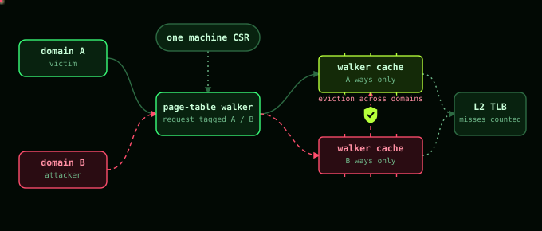

*Page walks from two domains used to share the walker caches, so one domain could time the other. TWIG gives each domain its own ways and tags every walk with the domain that issued it, because on an out-of-order core the walk can finish after the switch.*

**The problem.** Cache-way partitioning (Intel CAT, DAWG) and secure-TLB designs isolate the L1 data cache and the L1 TLB. On a TLB miss, the RISC-V page-table walker serves the request from its own leaf L2 TLB and optional non-leaf page-walk cache. These are PLRU-replaced, untagged by address space or domain, shared by all requestors, and survive a domain switch, so they carry a cross-domain timing channel that existing partitioning does not reach.

**Why I wrote it.** The secure-TLB literature explicitly left the page walk cache out of scope, on the premise that RISC-V had none; that premise no longer holds, since the rocket-chip walker used by Rocket, CVA6-class designs and BOOM keeps a leaf L2 TLB on by default. Prior secure-translation designs were also simulated or in-order, and they partition the instruction and data TLBs separately, which leaves the single shared walker behind both untouched.

**What we did.** The paper measures two channels through the walker caches on an out-of-order BOOM v4 core in Chipyard under Verilator, counting L2-TLB misses with the core's own performance counters because classification accuracy alone cannot tell an attenuated channel from a closed one. It then builds TWIG, a per-domain way-partition of the walker caches in synthesizable RTL, controlled by one machine CSR. The refill victim is confined to the ways of the domain that issued the walk, carried as a tag with the request, because on an out-of-order core a walk can complete after the domain has switched. A further variant gives each domain its own PLRU replacement tree. Area, capacity and domain-switch costs are measured against a flush-based alternative.

**What we found**

- A same-requestor channel through the shared L2 TLB displaces the attacker's translation in up to 31 of 32 trials at 98% accuracy.
- A new cross-requestor channel: a victim that only executes code displaces the attacker's data translation in 15 of 16 trials (96%), and a data-only victim displaces the attacker's code translation in 16 of 16, because one arbiter feeds both TLBs into one walker.
- TWIG drives displacement from 19-30 of 32 (median 25) to at most one, and classification to the 50-51% chance floor, at two, four or eight domains, for 113 cells (0.65%) and no added SRAM.
- With storage partitioned but the PLRU tree shared, a victim that only hits its own entries still steers which attacker entry is evicted at 93.6% accuracy; per-domain replacement state closes this for a further 421 cells (3.1% total).
- Capacity cost appears only when a domain's working set exceeds its 128/D share (worst observed +49%); after a domain switch, resumed code runs 1.7-1.8x faster than after a flush while it fits its share.
- Three BOOM v4 defects found, all reproducible with no partition present: unconnected walker custom CSRs, a dTLB translation-refill livelock, and an unapplied SFENCE.VMA refill-discard condition.

**Contributions**

- Measurement of two cross-domain channels through the page-table walker caches on out-of-order RISC-V RTL, one of them cross-requestor and, to the authors' knowledge, unreported.
- TWIG, a per-domain way-partition of the walker caches keyed by the issuing domain's tag, in synthesizable BOOM RTL.
- Evidence that partitioning storage alone is not enough: shared replacement state still leaks, supporting DAWG's position that replacement state must be isolated too.
- A methodology point: count structure-level misses rather than trust single-bit classification accuracy, and report results over ensembles of builds.
- Root-causing of three BOOM v4 defects, reported upstream.

**Abstract.** Deterministic cache partitioning (Intel CAT, DAWG) and recent secure-TLB designs isolate what an attacker probes directly: the L1 data array and the L1 TLB. A domain's translation footprint is not confined there. On a miss a shared page-table walker services it from its own caches: on RISC-V a set-associative leaf L2 TLB and, when enabled, a non-leaf page-walk cache, both PLRU-replaced, untagged by address space or domain, and shared by all requestors. Neither cache-way nor L1-TLB partitioning reaches them, and their contents survive a switch. On an out-of-order BOOM core we measure a cross-domain channel through the shared L2 TLB that displaces the attacker's translation in up to 31 of 32 trials at 98% accuracy, and a second one: because a single arbiter multiplexes the instruction and data TLBs onto the one walker, a victim that merely executes code displaces the attacker's data translation in 15 of 16 trials, and a victim doing only data accesses displaces its code translation in 16 of 16. Partitioning the two arrays separately, as prior designs do, cannot close that: the contention is behind both. We present TWIG, a per-domain way-partition of the walker caches in synthesizable RTL, keyed by the domain that issued the walk, not the one current when the refill lands, since walks outlive switches. We count L2-TLB misses with the core's own performance counters, because classification accuracy cannot separate an attenuated channel from a closed one. TWIG drives displacement from 19-30 of 32 to at most one and classification to the chance floor, for 113 cells and no added SRAM. Partitioning storage alone is not enough: a victim that evicts nothing and only hits its own entries still steers which of the attacker's entries dies, at 93.6%, because the replacement tree stays shared. Partitioning the tree closes that too, at four times the area. Three BOOM defects surfaced along the way, all reproducible with no partition present.

*Keywords: page-table walker, translation lookaside buffer, side channel, cache partitioning, RISC-V, BOOM, domain isolation, hardware security*

#### Closing a Spectre-v1 Cache Leak on BOOM with a Per-Domain Guard

Jyotiprakash Mishra, Sanjay K. Sahay, Swati Mishra, Lalit K. Vashishtha, Aman Pathak  
*14th IEEE International Conference on Intelligent Systems and Embedded Design (ISED 2026), NIT Warangal, Telangana, India, 18-20 December 2026*, 2026 · Scopus (IEEE conference proceedings)

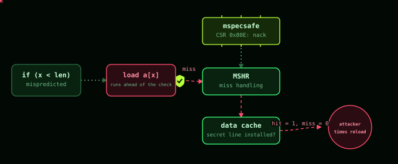

*In Spectre-v1 a mispredicted bounds check lets a load run ahead; its miss allocates an MSHR and the refill puts the secret line into the cache, where the attacker times it. mspecsafe refuses a missing load while any older branch is unresolved.*

**The problem.** Open out-of-order RISC-V cores such as BOOM let researchers study Spectre attacks and defenses on the exact RTL that will be fabricated. Timing measurement on this substrate is easy to get wrong: a flawed metric can report a leak where none exists, or report no leak while the attack is silently not running. Without a sound measurement, no defense can be evaluated.

**Why I wrote it.** The authors set out to measure what limiting the speculation window buys against Spectre-v1 on BOOM. Their first metric showed a channel with the gadget deleted, and their repaired metric then showed no channel at all, which was also wrong. RTL tracing also showed that BOOM v3's existing guard on miss allocation uses the wrong predicate, so the leak is present in v3 as well. The paper documents the full path so others do not repeat these errors.

**What we did.** A textbook bounds-check-bypass gadget is run on stock SmallBoomV4 and MediumBoomV4 in Chipyard under Verilator, with negative and positive controls and a paired differential metric. Three confounds are identified and removed: cross-line baseline asymmetry, first-trial warm residency, and branch-history contamination between training and attack call sites. Cycle-stamped data-cache instrumentation then shows the speculative load allocating an MSHR whose refill installs the secret line. The defense, mspecsafe (CSR 0x80E), nacks a load that misses while its branch mask is non-zero, per domain behind one CSR bit, and is checked with exhaustive SAT and Z3 and synthesized with Vivado.

**What we found**

- The secret line beats a control in 12 of 12 trials against 0-1 of 12, and a six-byte secret is recovered end to end.
- A cross-line baseline asymmetry reported a 47/50 'channel' with the gadget deleted; branch-history contamination produced a false negative that looked like a working defense.
- The speculative load allocates an MSHR whose refill installs the secret-indexed line 37 cycles later, before the probe hits; BOOM v3's !IsKilledByBranch guard does not stop it (v3 leaks 6/6).
- mspecsafe drives the channel from 12/12 to 2/12 (noise floor) while a positive control still registers.
- IPC cost is 0% on cache-resident code and under 1% on a serial pointer chase; window limiters that also close the channel cost 11% and 33% IPC.
- Synthesis adds zero registers to the data cache; LUTs move by -0.8% (within noise) and Fmax is unchanged (354 vs 353 MHz).

**Contributions**

- A reliable, end-to-end Spectre-v1 cache channel on BOOM v4.
- Three measurement pitfalls, each able to fake or hide the channel, with the controls that defeat them.
- White-box RTL confirmation of the leak, and the finding that BOOM v3's existing branch guard uses an insufficient predicate.
- A minimal per-domain delay-on-miss gate on the correct predicate (br_mask != 0), machine-checked by SAT and Z3 and synthesized at no frequency cost.

**Abstract.** We report a reliable Spectre-v1 cache channel on the out-of-order BOOM v4 RISC-V core, the measurement pitfalls that first hid it, and a minimal per-domain defense that closes it. On stock SmallBoomV4 and MediumBoomV4, a textbook bounds-check-bypass gadget speculatively installs the secret-indexed line in the L1 on every trial. Under a paired differential metric the secret line beats a control in 12 of 12 trials against 0-1 of 12, and we recover a six-byte secret end to end. Reaching this required defeating three confounds, each able to fake or hide the channel on its own: a cross-line baseline asymmetry that reports a leak even with the gadget deleted (47/50), a first-trial warm-residency artifact, and branch-history contamination that makes an aggregate null look exactly like a working defense. Cycle-stamped RTL instrumentation then watches a still-speculative load allocate a miss-status holding register whose refill installs the secret line before the probe hits. The same trace exposes a design defect. BOOM v3's existing guard, !IsKilledByBranch, fires only for a load killed in the current cycle, not one still speculative, so v3 leaks identically (6/6). Our defense mspecsafe gates miss allocation on the right predicate, br_mask != 0, per-domain behind a one-bit CSR. It drives the channel to the noise floor (12/12 to 2/12) while a positive control still registers, costs zero IPC on cache-resident code, is machine-checked correct by SAT and Z3, and synthesizes with zero added registers to the data cache and no change in maximum frequency.

*Keywords: Spectre-v1, transient execution, BOOM, RISC-V, delay-on-miss, flush+reload, measurement methodology, hardware security*

#### No-Op or No Security? A Backward-Compatible, Discoverable, Fail-Closed Contract for Security Directives in the RISC-V HINT Encoding Space

Jyotiprakash Mishra, Sanjay K. Sahay, Swati Mishra, Lalit K. Vashishtha, Aman Pathak  
*14th IEEE International Conference on Intelligent Systems and Embedded Design (ISED 2026), NIT Warangal, Telangana, India, 18-20 December 2026*, 2026 · Scopus (IEEE conference proceedings)

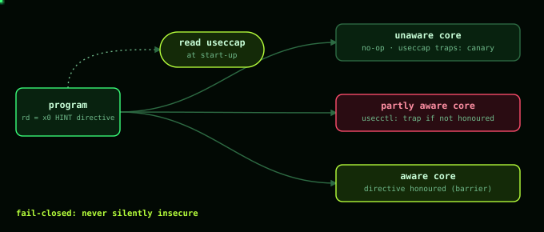

*A security directive is a HINT, a no-op to any core that does not know it. One read of useccap at start-up tells the program what the core will honour, and usecctl makes a partly aware core trap instead of silently doing nothing.*

**The problem.** RISC-V HINT encodings execute as no-ops on cores that do not recognize them, so security directives placed there (a speculation barrier, a constant-time region marker) are backward compatible. The same property is a hazard: on a core that ignores the directive, software runs unprotected and nothing reports it. The failure is fail-open and invisible.

**Why I wrote it.** Existing feature discovery (Arm ID registers and HWCAP, RISC-V misa) advertises presence but gives no per-directive fail-closed guarantee, and the HINT space has no enumeration at all. A HINT cannot itself report capability, since it writes no register. The authors found no prior work that states or builds a delivery-and-discovery contract for silently ignorable security instructions.

**What we did.** SafeHint has three parts. Directives are encoded as reserved rd=x0 HINTs, so they stay true no-ops on unaware cores. A user-readable capability CSR, useccap, returns a per-directive honored bitmap on an aware core and raises illegal-instruction on an unaware one, so a single read at start-up acts as a canary. An enforcement CSR, usecctl, makes an aware but partial core trap any directive it does not honor. The contract is implemented on BOOM v4 in Chipyard with a flush-based speculation barrier as the example directive, and evaluated under Verilator on null, partial and full cores.

**What we found**

- A directive-carrying binary produces the identical architectural result (checksum 0x17a3d6e7dc6f5a2a) on unaware, partial and full cores.
- The probe raises illegal-instruction (mcause=2) on the unaware core, returns bitmap 0x3 on the full core and 0x1 on the partial core.
- With enforcement on, an unhonored directive on the partial core traps (fail closed); with it off, it is a silent no-op.
- Decode and CSR cost is 56-63 two-input gate equivalents and one flip-flop, flat across bitmap widths 2 to 64 (yosys).
- The example barrier costs 26 cycles per insertion at every loop length, against 19 for fence and 61-81 for fence.i.

**Contributions**

- Identification of silent ignorability as a security hazard for directives carried in the RISC-V HINT space.
- A three-part contract: HINT carrier, trapping capability-probe CSR as canary, and an enforcement CSR for partial implementations.
- An implementation on out-of-order BOOM v4 RTL with measured no-op equivalence, canary behavior, fail-closed enforcement and area.
- A design that is independent of the action carried, so new directives can be added under the same bitmap and trap.

**Abstract.** The RISC-V HINT encoding space is an appealing place to carry security directives. Because unaware cores execute HINTs as architectural no-ops, a directive placed there is backward compatible. The same property is a hazard. A security directive that is silently ignored on hardware that does not implement it gives a false sense of security: software proceeds as if protected when it is not. Backward compatibility and security enforcement are therefore in tension. We address this with SafeHint, a three-part contract. First, directives ride reserved HINT encodings, so they are architecturally inert on unaware cores, which we verify with a bit-identical execution trace. Second, a capability-probe control and status register (CSR), useccap, acts as a canary: it returns a per-directive support bitmap on an aware core and raises an illegal-instruction exception on an unaware one, so software can detect a silent downgrade even on a core that cannot be made to trap the HINT itself. Third, an enforcement CSR, usecctl, makes an aware-but-partial core trap any unhonored directive, so partial implementations also fail closed. We implement SafeHint on the out-of-order BOOM v4 core in a fresh Chipyard checkout and evaluate it under Verilator. We report bit-identical architectural execution of a directive-carrying binary on an unaware core and on a core that honors the directive, the probe canary firing on both an unaware and an aware core, fail-closed behavior on a partial implementation, and a decode and CSR cost of about 60 two-input gate equivalents plus one flip-flop. The contribution is the delivery-and-discovery contract rather than any single defense; a speculation barrier serves as a concrete, measured vehicle.

*Keywords: RISC-V, HINT encoding, ISA extension, hardware security, speculation barrier, backward compatibility, fail-closed, BOOM*

#### Catching the Set Builder: Hardware Detection of Eviction-Set Construction at the Shared LLC on RISC-V

Jyotiprakash Mishra, Sanjay K. Sahay, Swati Mishra, Lalit K. Vashishtha, Aman Pathak  
*5th International Conference on Computing, Communication and Learning (COCOLE 2026), NIT Raipur, Chhattisgarh, India, September 2026; proceedings in Springer Communications in Computer and Information Science (CCIS)*, 2026 · Scopus (Springer CCIS)

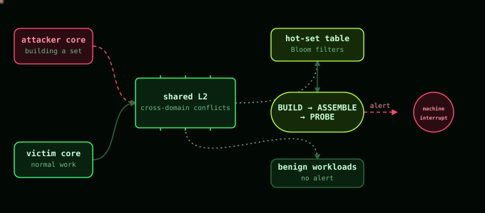

*Before Prime+Probe works, the attacker must build an eviction set, and that leaves a trail of cross-domain conflicts in a few cache sets. SetSentry watches only those sets and raises an interrupt when the build, assemble, probe pattern completes.*

**The problem.** Contention-based cache attacks such as Prime+Probe and Evict+Reload on a shared last-level cache must first build an eviction set: many addresses that map to one cache set. Existing detectors watch symptoms such as eviction rate or cyclic interference, which benign workloads also produce, so they raise false alarms. An attacker who slows its probing flattens rate and performance-counter signals and evades them.

**Why I wrote it.** The literature treats eviction-set construction and eviction rate as one phenomenon. The authors argue they differ: construction has a structural fingerprint, one domain touching many distinct lines that conflict in the same set, that benign cache pressure lacks. A detector built on that fingerprint can be both more discriminating and independent of attacker speed. Prior detectors such as Cyclone and CC-Hunter were evaluated only in architectural simulators.

**What we did.** SetSentry is a passive, domain-aware monitor on the shared inclusive L2 that counts distinct cross-domain conflicting lines per set. It tracks only sets under cross-domain contention in a small direct-mapped Hot-Set Table with Bloom filters, and alerts only after a BUILD, ASSEMBLE, PROBE lifecycle state machine completes, with a per-set activity-based decay window. It raises a machine interrupt and drives no cache signal. It is implemented in synthesizable RTL on a dual-core Rocket SoC in Chipyard, evaluated under Verilator against working cross-core Prime+Probe and Evict+Reload channels and three benign workloads, compared with rate and Cyclone-style interference detectors, cross-validated with a bit-accurate model, and checked by randomized RTL property testing.

**What we found**

- Only SetSentry detects both attacks with no benign false positives: 0/3, against 3/3 for the rate detector and 2/3 for the interference detector.
- It alerts 31 accesses after the attacker assembles its 7th conflicting line, before 99% of the target set's accesses (4577 of 4623).
- It keeps detecting across a 256x attacker slowdown; the rate detector is evaded at 32x and the interference and wall-clock-windowed detectors at 64x.
- A detecting configuration (8 entries, 32-bit Bloom) costs 2518 flip-flops and 5898 gates; detection holds for table sizes from 8 to 128.
- Property checks over 5000 trials each show no single-domain or sub-threshold false alarms and no missed detection for realistic eviction sets.
- The attack channels are real: Prime+Probe probe latency rises from 441 to 497 cycles (+12.7%) when the victim evicts.

**Contributions**

- A structural detection signal: distinct lines a foreign domain causes to conflict per set.
- An attack-lifecycle state machine that rejects benign transients.
- Detection that is invariant to the attacker's access rate.
- A low-area Hot-Set Table whose cost scales with contended sets, not cache size.
- A synthesizable RTL implementation on an open RISC-V SoC with cross-validated model, property verification and area characterization.

**Abstract.** Contention-based cache side channels (Prime+Probe, Evict+Reload) share a necessary first step: the attacker must construct an eviction set, a group of addresses that map to one cache set and collectively fill its ways. This construction has a structural signature that benign cache pressure lacks: one security domain touches many distinct lines that conflict in the same set, whereas benign cache-stressing workloads (streaming, producer-consumer, pointer-chasing) revisit a small footprint per set. We present SetSentry, a passive, domain-aware last-level-cache (LLC) monitor that detects eviction-set construction in hardware by counting distinct cross-domain conflicting lines per set, gated by a BUILD->ASSEMBLE->PROBE lifecycle state machine, in a compact Hot-Set Table whose area scales with the sets under contention, not with cache size. The signal is structural, hence invariant to the attacker's access rate: slowing down, the move that defeats rate- and performance-counter-based detectors, does not evade it. Implemented as synthesizable RTL on the inclusive L2 of a dual-core RISC-V Rocket SoC in Chipyard and evaluated under cycle-accurate Verilator simulation on working cross-core Prime+Probe and Evict+Reload channels, SetSentry is the only one of the rate, interference, and structural detectors we compare that detects both attacks with no benign false positives; it alerts once the eviction set is assembled, before 99% of the probing; it keeps detecting across a 256x attacker slowdown that evades the baselines; it works with Hot-Set Tables down to 8 entries (about 2.5k flip-flops); and randomized RTL property checking confirms no single-domain or sub-threshold false alarms and no missed detection for realistic eviction sets.

*Keywords: cache side channel, eviction set, Prime+Probe, hardware detector, last-level cache, RISC-V, hardware security*

#### The Replacement Policy Is a Side Channel: Closing the Reload+Refresh Leak at the Policy Level on RISC-V

Jyotiprakash Mishra, Sanjay K. Sahay, Swati Mishra, Lalit K. Vashishtha, Aman Pathak  
*5th International Conference on Computing, Communication and Learning (COCOLE 2026), NIT Raipur, Chhattisgarh, India, September 2026; proceedings in Springer Communications in Computer and Information Science (CCIS)*, 2026 · Scopus (Springer CCIS)

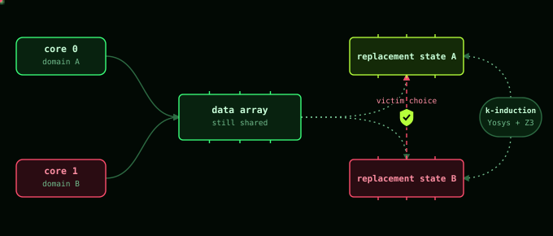

*Reload+Refresh leaks through the replacement state, not the data: the victim's access changes which line the attacker loses next. DIRS keeps the data shared but gives each domain its own small replacement state, and proves the domains cannot see each other.*

**The problem.** Randomized caches (CEASER, ScatterCache, Mirage) and way partitioning (DAWG, CAT) defend where data is placed in a shared last-level cache. Neither protects the replacement policy, whose state also leaks. In Reload+Refresh an attacker learns a victim's access to a shared line from how it reorders the PLRU state, without evicting the target, which makes the channel stealthier than contention.

**Why I wrote it.** Reload+Refresh had only been shown on closed Intel parts, whose replacement state cannot be inspected or changed. It was unknown whether the leak exists in open hardware and whether it can be removed cheaply at its source. The authors also wanted to test the conjecture that a replacement-state channel bypasses randomization.

**What we did.** On a dual-core Chipyard SoC with a shared inclusive L2, using both the in-order Rocket and the out-of-order BOOM, the authors build a cross-core Reload+Refresh covert channel. DIRS (Domain-Isolated Replacement State) replicates only the small per-set replacement metadata per security domain while the data array stays fully shared, so a domain's victim selection depends only on its own accesses. Non-interference is proved by unbounded k-induction with Yosys and Z3. DIRS is synthesized with Vivado on Kintex UltraScale+ and evaluated for security, area, timing, domain scaling and throughput, and the channel is also tested against a CEASER-style randomized cache.

**What we found**

- The Reload+Refresh covert channel reaches 100% accuracy on a deterministic-PLRU L2 on both Rocket and BOOM.
- DIRS reduces it to 48% (chance) on both cores.
- DIRS costs +73 LUTs (1.1% of the L2), +3 flip-flops and 2 block-RAM tiles of metadata; the data array is byte-identical and Fmax is unchanged.
- Metadata stays at or below 2.7% of capacity through 16 domains.
- Single-domain overhead is zero and two domains that fit the L2 run at the same 19 cycles per access; only a 2x overcommit costs more (35 vs 31 cycles, +13%).
- Negative result: the channel does not bypass randomization, since it also needs an eviction set, so randomization and DIRS are complementary.

**Contributions**

- The first open-RTL Reload+Refresh channel on RISC-V, on in-order and out-of-order cores.
- DIRS, a policy-level defense that isolates replacement state per domain without partitioning capacity.
- A machine-checked non-interference proof by unbounded k-induction.
- Low-cost FPGA synthesis results and a domain-count scaling study.
- An analysis showing replacement-state isolation and address randomization are orthogonal and composable.

**Abstract.** Randomized caches (CEASER, ScatterCache, Mirage) and way partitioning (DAWG, CAT) are the dominant microarchitectural defenses against last-level cache (LLC) side channels. Both target where data is placed: partitioning splits capacity, randomization scrambles the address-to-set map. Neither addresses the cache replacement policy, whose state is itself a side channel exploited by the stealthy Reload+Refresh attack. On an open, synthesizable dual-core RISC-V SoC (the in-order Rocket and the out-of-order BOOM) with a shared inclusive L2, we implement, to our knowledge, the first open-RTL Reload+Refresh covert channel on RISC-V, achieving 100% accuracy on a deterministic-PLRU LLC. We then introduce DIRS (Domain-Isolated Replacement State), which replicates only the small per-set replacement metadata per security domain while keeping the data array fully shared, so that one domain's accesses cannot influence another domain's victim selection; DIRS reduces the channel to the noise floor (100% -> 48%, i.e. chance) on both cores, and we machine-check the non-interference property by unbounded k-induction (Yosys+Z3). Synthesized with Vivado for a Kintex UltraScale+ part, DIRS costs +73 LUTs (1.1% of the L2), +3 flip-flops, and 2 block-RAM tiles of metadata, with the data array byte-identical and the maximum clock frequency unchanged. A negative result bounds the threat: the stealthy channel does not bypass randomization (both channels need an eviction set), so randomization and DIRS are complementary, not competing.

*Keywords: cache side channel, Reload+Refresh, replacement policy, PLRU, RISC-V, hardware security, formal verification*

#### Memory Security: From Cold Boot Attacks to Side-Channel Defenses

Jyotiprakash Mishra, Sanjay K. Sahay, Swati Mishra, Aman Pathak  
*International Conference on Information and Communication Technology for Intelligent Systems (ICTIS 2026), proceedings in Springer Lecture Notes in Networks and Systems (LNNS)*, 2026 · Scopus (Springer LNNS)

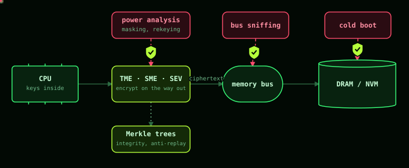

*Memory can be frozen and read, sniffed on the bus, replayed, or attacked through the power drawn by the very engine that encrypts it. The review follows each attack to the defences built against it.*

**The problem.** Data in DRAM is exposed on the path between the CPU and memory. Attackers can read residual DRAM contents after power-off (cold boot), probe the memory bus, replay or tamper with stored lines, and recover keys from encryption engines by power analysis. Storage encryption does not protect this volatile data.

**Why I wrote it.** Hardware memory encryption is now shipped by Intel and AMD, but the threats, the vendor mechanisms, integrity trees and side-channel countermeasures are described in separate bodies of work. The authors wrote a single review for hardware engineers that ties these together and states the security guarantees and performance trade-offs of each. It supports the authors' own research line on memory encryption engines for RISC-V.

**What we did.** The paper reviews cold boot attacks and layered mitigations; bus sniffing attacks such as Membuster and address and timing countermeasures; Intel TME, MKTME and AMD SME/SEV; integrity protection with Merkle trees, Bonsai Merkle trees, parallelizable and hybrid trees and replay-aware designs; granular per-page and per-VM memory encryption, including non-volatile memory; and simple and differential power analysis with masking, rekeying, circuit-level balancing and randomized execution.

**What we found**

- Cold boot remains effective across DRAM generations; no single countermeasure suffices, so inline encryption, key eviction, boot-time scrubbing, key vaults and NVM cleansing are layered.
- Inline AES-XTS hides data on the bus but not line addresses or access timing, which need address scrambling and timing shaping.
- Bonsai Merkle trees reduce DRAM hash overhead from about 12% to under 1% by caching upper tree levels on chip.
- Granular schemes such as MKTME (up to 32 key slots) and SEV isolate tenants, at measurable key-switch and mixed-page costs.
- Stacking power-analysis defenses such as masking and power balancing gives more than additive protection, but each layer adds area, latency or energy.

**Contributions**

- A structured survey of memory-security threats from cold boot to power analysis.
- A comparison of commercial memory encryption (TME, MKTME, SME/SEV) by key model and isolation.
- A summary of integrity-tree designs and their overheads.
- A catalogue of DPA and SPA countermeasures relevant to memory-encryption engines, with open challenges for heterogeneous and non-volatile systems.

**Abstract.** Memory encryption is a key security requirement for modern computing systems, addressing vulnerabilities between CPUs and main memory. Traditional storage encryption is insufficient for protecting volatile data in RAM, which remains exposed to bus sniffing, cold boot attacks, and side-channel exploits. This paper therefore systematically reviews memory encryption techniques focused on hardware-based solutions like Intel Total Memory Encryption (TME), Multi-Key TME, and AMD Secure Memory Encryption, which provide robust protection while minimising performance overhead. The paper also explores integrity protection via Merkle trees and side-channel countermeasures against Differential Power Analysis and Simple Power Analysis attacks. Additionally, granular memory encryption methods for multi-tenant environments are discussed, highlighting their role in isolating sensitive data across security domains. By examining security guarantees and performance trade-offs, we emphasise the necessity of efficient memory encryption to safeguard against evolving threats targeting the CPU-memory interface, providing hardware engineers a foundation for ensuring data confidentiality and integrity.

*Keywords: memory encryption, cold boot attacks, bus sniffing, integrity protection, hardware security, side-channel attacks*

### Preprints

#### Modern Hardware Security: A Review of Attacks and Countermeasures

Jyotiprakash Mishra, Sanjay K. Sahay  
*arXiv preprint arXiv:2501.04394 (cs.CR; cs.AR)*, 2025 · arXiv · DOI [10.48550/arXiv.2501.04394](https://doi.org/10.48550/arXiv.2501.04394)

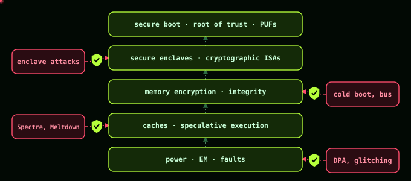

*Hardware security in layers, from the physics of the chip up to the code that boots it, with the attacks that cross each layer and the countermeasures that stop them.*

**The problem.** Cloud services, smart devices and IoT have made hardware a common target. Attacks such as Spectre and Meltdown, power analysis, voltage glitching, electromagnetic analysis and fault injection extract secrets from the physical behavior of chips. Defending against them requires designers to understand many separate attack classes at once.

**Why I wrote it.** Hardware security knowledge was scattered across cache side channels, power analysis, memory encryption, secure enclaves, cryptographic ISAs, secure boot, PUFs and fault injection, each with its own literature. The authors wrote one review that connects attacks to mitigations across these areas, with a dedicated section on RISC-V because its openness and extensibility raise new problems. It also served as the literature base for my doctoral work on RISC-V side-channel security.

**What we did.** The paper first explains the concepts behind each area: cache organization and side channels, power side channels (SPA, DPA, CPA, template attacks), memory encryption (confidentiality, granularity, key management, masking, rekeying), secure enclaves, cryptographic ISAs, secure boot and root of trust, PUFs and hardware fault injection. It then reviews attacks and their mitigations for speculative execution, DPA, memory, secure enclaves, secure boot and root of trust, and fault injection. A final section focuses on RISC-V: speculative execution, power analysis, memory encryption and cryptographic ISA extensions.

**What we found**

- Covers eight hardware security areas and pairs each attack class with its mitigation patterns.
- Draws on a bibliography of 373 references.
- Concludes that isolation, secure microcode updates, speculative execution controls, cache partitioning, randomized execution, masking and frequent rekeying are needed together.
- My most cited work: 41 citations on Google Scholar and 27 on Semantic Scholar as of October 2026.

**Contributions**

- A single review spanning cache, power and EM side channels, memory encryption, enclaves, crypto ISAs, secure boot, PUFs and fault injection.
- A structured pairing of attacks with countermeasures in each area.
- A dedicated analysis of security challenges in the RISC-V architecture.
- A reference for researchers and designers building side-channel resistant hardware.

**Abstract.** With the exponential rise in the use of cloud services, smart devices, and IoT devices, advanced cyber attacks have become increasingly sophisticated and ubiquitous. Furthermore, the rapid evolution of computing architectures and memory technologies has created an urgent need to understand and address hardware security vulnerabilities. In this paper, we review the current state of vulnerabilities and mitigation strategies in contemporary computing systems. We discuss cache side-channel attacks (including Spectre and Meltdown), power side-channel attacks (such as Simple Power Analysis, Differential Power Analysis, Correlation Power Analysis, and Template Attacks), and advanced techniques like Voltage Glitching and Electromagnetic Analysis to help understand and build robust cybersecurity defense systems and guide further research. We also examine memory encryption, focusing on confidentiality, granularity, key management, masking, and re-keying strategies. Additionally, we cover Cryptographic Instruction Set Architectures, Secure Boot, Root of Trust mechanisms, Physical Unclonable Functions, and hardware fault injection techniques. The paper concludes with an analysis of the RISC-V architecture's unique security challenges. The comprehensive analysis presented in this paper is essential for building resilient hardware security solutions that can protect against both current and emerging threats in an increasingly challenging security landscape.

*Keywords: Hardware Security, Cyber-security, Cache Side Channels, Cryptographic Instruction Set Extensions, Fault Injection, Memory Encryption, Power Analysis Attacks, RISC-V, Secure Boot, Side-Channel Resistant Design, Speculative Execution*

## Papers under review

- opticc: Worker-Side Preprocessing, Communication-Aware Dispatch and a Shared Compile Cache for Distributed C/C++ Builds
- Revisable Machine Descriptions: Twenty-Four Facts a Running Guest Can Be Told Again
- Straight-Through Training as Sigma-Delta Modulation: Exact Dither Penalties, Duty-Cycle Rounding, and Quantizer Design for Ternary Networks
- xv6, Line by Line: A Verified, Interactive Commentary and Lab Curriculum for Training Kernel Developers
- Knowledge Certificates: Distribution-Free Guarantees on Which Facts Survive Quantization
- Near-Miss Retrieval: Contrastive Case Retrieval for Entity Disambiguation in Retrieval-Augmented Generation
- Parametric Knowledge Delta: Measuring, Compressing and Retrieving Knowledge Graphs Against a Language Model's Prior
- Surprisal Is a Time Series: Prequential Calibration Auditing of Language Models with Zero-Shot Forecasting Foundation Models

Also 2 papers under double-blind review; titles withheld until the decision, details on request.

## Patents

Six published patent applications from my doctoral work: hardware inside RISC-V processors that watches for attacks, encrypts what leaves the chip, and manages memory.

### Hardware data-flow integrity monitor with register-file provenance tagging for RISC-V IoT processors

Jyotiprakash Mishra, Sanjay K. Sahay, Swati Mishra, Aman Pathak  
Application 202631036811 · Publication IN202631036811 A1 · Published patent application (not yet granted)

**The problem.** Many attacks on IoT devices do not hijack control flow at all. They corrupt data: an untrusted input ends up as a store address, a branch target or a key, or a spoofed sensor value is used as if it had been validated. Control-flow integrity, memory tagging and pointer authentication do not track where a value came from, and software data-flow integrity costs too much on a small core.

**Why.** The thesis showed that defences for small RISC-V cores must be cheap enough to leave on all the time. Existing hardware protects only control flow or memory safety, so there was no always-on mechanism that tracks the provenance of data at the register level and enforces how data of a given origin may be used.

**How it works.** Every architectural register gets a small companion tag that records where its value came from, for example sensor-raw, sensor-validated, constant, computed, pointer, crypto-key, control or tainted (16 classes in 4 bits). When an instruction retires, a propagation unit computes the destination tag from the source tags using a programmable rules table. Loads take their tag from an address-region map, so data read from a sensor or an untrusted buffer is tagged automatically. A policy unit checks the tag whenever a register is used in a sensitive place (branch target, store address, CSR write, crypto operand) and raises a violation if that origin is not allowed there. The monitor runs beside the pipeline, so instructions that do not violate a policy pay no extra latency.

**What it claims**

- A RISC-V processor with a provenance tag file holding a multi-bit tag for each integer register.
- A tag propagation unit that sets the destination tag at retirement from the instruction type, the source tags and a programmable propagation rules table (an SRAM indexed by operation class and the two source tags).
- An address-tag mapping table of base, mask and tag entries that tags loaded data by its source address.
- A policy enforcement unit that checks tags in security-relevant contexts and raises a violation; tag work runs in parallel with execute and decode, so non-violating instructions see no added latency.
- Corresponding method and IoT system-on-chip claims.

**Measurements** (Implemented in Chisel on Konark-V, the authors' own dual-hart RV32IM microcontroller (153/153 core tests pass), and placed and routed with Vivado 2020.1 on a Xilinx Zynq XC7Z020 (Zedboard). Numbers are Vivado post-route output; the patent specification describes a larger instance than the one measured.)

- 230 LUTs (0.43% of the XC7Z020), 428 flip-flops, 0 BRAM, 0 DSP for 32 tags and 4 address regions.
- Fmax 139.4 MHz, above the 86 MHz Konark-V core clock, so the monitor never limits the core.
- 0.106 W total on-chip power, of which 4 mW is dynamic.
- 0 cycles of added latency on non-violating instructions and 0 cycles from taint to trap; about 29 pJ per instruction (derived).
- Validated on a control-data attack pattern: a tainted load used as a store address or branch target is flagged, and a clean register is not (no false positive).

### Hardware-accelerated microarchitectural event classifier with programmable feature extraction pipeline and on-chip ensemble inference engine for real-time malware detection in RISC-V processors

Jyotiprakash Mishra, Sanjay K. Sahay, Swati Mishra, Aman Pathak  
Application 202631036812 · Publication IN202631036812 A1 · Published patent application (not yet granted)

**The problem.** Hardware performance counters can tell malware from benign code, but every deployed detector reads them from software. That costs 2% to 15% of CPU time, samples only every 1 to 10 ms (so short attacks fall between samples), and runs as software that malware can disable or evade by timing camouflage instructions to the sampling points.

**Why.** My doctoral work on hardware-assisted malware detection found that the weak point of counter-based detection is the software pipeline, not the idea. Moving capture, feature extraction and classification into hardware removes the overhead, the sampling gaps and the software attack surface at once.

**How it works.** A capture unit taps the performance counters through a private port, so it does not use the normal CSR read path, and produces an event-count vector per time window. A five-stage fixed-point pipeline computes mean, variance, skewness, kurtosis and entropy for each event. A random forest of decision trees, stored in programmable on-chip SRAM, is walked in parallel by one traversal unit per tree, and a majority vote gives the verdict. A resilience monitor uses CUSUM change detection and an instruction-to-event consistency check to spot malware that tries to disguise its counter profile. A Linux kernel module loads trained models and acts on verdicts; retraining only reloads the tree tables.

**What it claims**

- A classifier with a direct event-tap capture unit (shadow accumulators and per-window difference calculator) independent of the CSR read port.
- A pipelined fixed-point feature engine computing mean, variance, skewness, kurtosis and entropy.
- An SRAM-based tree memory with parallel tree traversal units and a majority-vote aggregator, loaded through a CSR interface (for example 64 trees of depth up to 7 traversed in 7 cycles).
- An adversarial resilience monitor and a per-process context tracker that tags each event vector with a process identifier.
- Method claims and a RISC-V SoC claim with a Linux kernel security module.

**Measurements** (Implemented in Chisel on Konark-V, the authors' own dual-hart RV32IM microcontroller (153/153 core tests pass), and placed and routed with Vivado 2020.1 on a Xilinx Zynq XC7Z020 (Zedboard). Numbers are Vivado post-route output; the patent specification describes a larger instance than the one measured.)

- Measured instance: 4 trees x 16 nodes, depth 3, 8 features. 1,542 LUTs (2.9%), 1,869 flip-flops, 0 BRAM, 0 DSP.
- Fmax 55.7 MHz; one classification per cycle, i.e. 17.9 ns per verdict and 55.7 million verdicts per second (derived).
- 0.116 W total, 13 mW dynamic; about 233 pJ per classification (derived).
- Validated on five counter snapshots: multi-level traversal, per-tree votes and majority voting behave as programmed, with no false positive on the low-counter snapshot.

### Per-peripheral cryptographic session engine with hardware key rotation for RISC-V IoT system-on-chip

Jyotiprakash Mishra, Sanjay K. Sahay, Swati Mishra, Aman Pathak  
Application 202631036813 · Publication IN202631036813 A1 · Published patent application (not yet granted)

**The problem.** Inside a system-on-chip, data between the processor and peripherals (ADCs, sensors, crypto accelerators, secure storage) travels in plaintext. Bus probing, fault injection, an open JTAG or debug port, or a hardware Trojan can read it directly. TrustZone, PMP and SiFive Shield isolate software but do not encrypt the internal bus, and none give each peripheral its own key.

**Why.** The thesis studies how hardware leaks secrets on small RISC-V systems, including memory encryption. The internal bus was the remaining plaintext path. A lightweight, single-cycle cipher makes it possible to encrypt that path at bus speed, and doing key rotation in hardware removes it as something software can forget or be tricked into skipping.

**How it works.** A key-slot register file holds a separate 128-bit session key and transaction counter for each peripheral channel; firmware loads the keys at secure boot and software cannot read them back. Each bus transaction is encrypted with PRINCE, a low-latency 64-bit block cipher, using the channel key with the transaction counter as a tweak, so the same data never produces the same ciphertext twice. A key-rotation state machine watches each counter and, at a configured threshold, derives a new key by enciphering the old one and swaps it in atomically. Small decrypt and encrypt stubs next to each peripheral complete the channel. Compromise of one channel's key does not expose the others.

**What it claims**

- A RISC-V SoC with a per-peripheral cryptographic session engine on the internal bus and a key-slot register file of per-channel keys, counters and configuration bits.
- A lightweight block cipher (PRINCE) performing single-cycle encryption and decryption with the transaction counter as a tweak.
- An autonomous key-rotation finite state machine that derives and commits new keys when a channel's counter crosses its threshold, without processor involvement.
- Peripheral-side cryptographic stubs and bus interception logic that select the key by target peripheral.
- Method claims and a secure IoT SoC claim.

**Measurements** (Implemented in Chisel on Konark-V, the authors' own dual-hart RV32IM microcontroller (153/153 core tests pass), and placed and routed with Vivado 2020.1 on a Xilinx Zynq XC7Z020 (Zedboard). Numbers are Vivado post-route output; the patent specification describes a larger instance than the one measured.)

- PRINCE-64 core is bit-exact against all 5 published test vectors, in both a Scala reference model and the synthesised hardware.
- Full 4-channel engine: 3,642 LUTs (6.85%), 752 flip-flops, 0 BRAM, 0 DSP; one unrolled cipher alone is 1,192 LUTs.
- Fmax 38.7 MHz with a single-cycle, fully unrolled 12-round cipher (26.5 ns combinational path); 0.503 W total, 0.394 W dynamic.
- Derived bus-encryption throughput 2.48 Gbit/s at about 159 pJ/bit (10.2 nJ per 64-bit block).
- Waveform shows the key changing on its own as transactions accumulate and the rotation flag setting at the threshold.

### On-chip binary decision tree inference engine integrated with RISC-V trace encoder for real-time IoT security monitoring

Jyotiprakash Mishra, Sanjay K. Sahay, Swati Mishra, Aman Pathak  
Application 202631036814 · Publication IN202631036814 A1 · Published patent application (not yet granted)

**The problem.** RISC-V trace encoders (N-Trace, E-Trace) already see every branch, return and exception, but they only record and export it for offline analysis. Attacks such as return-oriented programming, code injection and control-flow hijacking finish long before external analysis can respond. ARM PAC and Intel CET do not exist on RISC-V, and software CFI is too heavy for IoT cores.

**Why.** The execution evidence needed to catch these attacks is already on the chip, in the trace path. The gap was that nothing analysed it in place. A small decision tree is cheap enough to evaluate in hardware every cycle, which gives detection without new instrumentation.

**How it works.** A feature extractor reads trace packets and keeps running counts over a sliding window of recent instructions: branch frequency, return-address consistency, instruction mix, indirect-jump target spread and interrupt rate, each quantised to 4 bits. A pre-trained binary decision tree in a small on-chip SRAM is walked node by node over these features and gives a classification within eight clock cycles. An alert controller with a confidence accumulator (several anomalous verdicts in a row before a severe response) can log, raise a non-maskable interrupt, halt into debug, or inject an alert into the trace stream. Only machine mode can update the model.

**What it claims**

- A RISC-V processor with an anomaly detection engine coupled to the trace encoder output, including a trace feature extractor.
- A binary decision tree inference unit with node words (leaf flag, feature selector, threshold, child pointers, class) in on-chip SRAM, giving a classification in a bounded number of cycles.
- An alert and response controller with a confidence accumulator and configurable responses (log, NMI, debug halt, trace injection).
- Machine-mode-only CSR interface for secure model updates.
- Method claims and an IoT SoC claim.

**Measurements** (Implemented in Chisel on Konark-V, the authors' own dual-hart RV32IM microcontroller (153/153 core tests pass), and placed and routed with Vivado 2020.1 on a Xilinx Zynq XC7Z020 (Zedboard). Numbers are Vivado post-route output; the patent specification describes a larger instance than the one measured. The measured version extracts features from the commit stream rather than from encoded trace packets.)

- Measured instance: 16-commit sliding window and 16-node tree. 307 LUTs (0.58%), 405 flip-flops, 0 BRAM, 0 DSP.
- Fmax 70.6 MHz; inspects every committed instruction. 0.110 W total, 7 mW dynamic.
- ROP burst detected after 13 commits (about 184 ns) with 0 false positives in the test traces.
- The anomaly clears once benign instructions push the burst out of the window, which shows the O(1) sliding-window subtract works.

### RISC-V processor architecture with tiered-memory ISA extension, tier-aware translation lookaside buffer, and Thunderbolt-attached external DRAM expansion with RISC-V bridge controller for Linux-based heterogeneous memory systems

Jyotiprakash Mishra, Sanjay K. Sahay, Swati Mishra, Aman Pathak  
Application 202631036815 · Publication IN202631036815 A1 · Published patent application (not yet granted)

**The problem.** Workloads such as LLM inference, virtual machines and EDA often need more memory than a consumer machine has. CXL memory expansion exists only on server processors. Linux can tier memory, but page migration is done in software (unmap, copy 4 KB through the CPU, update page tables, flush TLBs), which is too slow for a high-latency external tier. No ISA has instructions that know about memory tiers.

**Why.** RISC-V's custom opcode space, reserved page-table bits and custom CSRs make it possible to put tier awareness into the ISA itself. Thunderbolt 5 offers 80 Gbps on consumer hardware but had not been used for DRAM expansion with NUMA integration.

**How it works.** Layer 1 is an ISA extension, Xmtier, with tier-aware loads and stores (LD.TIER, SD.TIER), a page-migration instruction (MIGRATE), a tier statistics instruction (TIERSTAT) and a load-wait instruction (LWAIT). The TLB gains a 2-bit tier field per entry so the load/store unit can adapt to slow memory, an asynchronous load queue lets slow-tier loads proceed without stalling the core, and a hardware engine moves pages between tiers and shoots down TLB entries when done. Layer 2 is an external Thunderbolt enclosure built around a RISC-V bridge controller with custom DDR5 instructions, a latency-hiding cache with firmware prefetch and a write-snoop invalidation protocol for coherence without CXL. Layer 3 is a Linux kernel module that registers the external DRAM as a NUMA node and handles hot-plug.

**What it claims**

- A RISC-V processor with the Xmtier tiered-memory ISA extension and a tier-aware TLB holding a tier field per entry.
- An asynchronous load queue for non-blocking access to high-latency tiers and a hardware page migration engine with automatic TLB shootdown.
- A RISC-V SoC bridge controller for connecting external DRAM over Thunderbolt or USB4, with custom DDR5 command instructions and a latency-compensating cache.
- A Linux kernel integration module for ACPI SRAT/HMAT injection, NUMA node registration, hardware-accelerated migration and hot-plug.
- The Xmtier encoding itself, in the RISC-V custom-1 opcode space.

**Measurements** (Implemented in Chisel on Konark-V, the authors' own dual-hart RV32IM microcontroller (153/153 core tests pass), and placed and routed with Vivado 2020.1 on a Xilinx Zynq XC7Z020 (Zedboard). Numbers are Vivado post-route output; the patent specification describes a larger instance than the one measured.)

- Measured scope is the on-chip control core only (tier table, heat-based migration, coldest-page eviction, pin instruction, async load queue), not the Thunderbolt device or kernel layers.
- 8 pages, fast-tier capacity 2, 4-slot queue: 144 LUTs (0.27%), 71 flip-flops, 0 BRAM, 0 DSP; Fmax 86.4 MHz; 0.105 W total, 2 mW dynamic.
- Average access latency 2.40x lower than without tiering (6.00 to 2.50 cycles, 70% fast-tier hits) over an 80-access simulated trace.
- Validated hot-page promotion, correct coldest-page eviction and out-of-order completion of a fast load ahead of an outstanding slow load.

### Programmable instruction fusion engine with SRAM-based rules table for RISC-V IoT processors

Jyotiprakash Mishra, Sanjay K. Sahay, Swati Mishra, Aman Pathak  
Application 202631036816 · Publication IN202631036816 A1 · Published patent application (not yet granted)

**The problem.** Macro-op fusion (for example LUI+ADDI into one 32-bit constant load) saves pipeline slots and energy, but in Intel, ARM, BOOM and commercial RISC-V cores the fusible pairs are hardwired. An IoT chip runs very different code (sensor filtering, cryptography, control loops, radio protocols) over a 5 to 10 year life, and a fixed rule set helps one workload and not the others.

**Why.** I wanted the benefit of fusion on small RISC-V cores without fixing the choice of patterns at tape-out. Storing rules in SRAM, written through CSRs, makes fusion a software decision, and banking the table lets each task bring its own rules.

**How it works.** A fusion detection unit sits between the fetch buffer and the decoder. Each rule entry in an SRAM table describes a pair of instructions (opcode and function-field masks), the register dependency required between them, and the fused micro-op to emit. Match logic compares the current pair against all rules in one cycle, a priority encoder picks one if several match, and a generator emits a single internal operation. A dependency check makes sure the second instruction really consumes the first one's result, so fusion never changes program meaning. The table is banked, and one CSR write switches banks at a context switch. A fusion counter supports profiling, and a constant-time mode can disable fusion for security-sensitive code.

**What it claims**

- A RISC-V processor with a fusion detection unit containing an SRAM-based rules table, parallel match logic and a fused micro-op generator.
- A 48-bit rule entry format: opcode and function-field masks for both instructions, register dependency flags, fused micro-op type, latency hint, priority and enable bit.
- A banked rules table switched in a single cycle by a CSR write, giving zero-overhead rule-set changes at context switches.
- A register-dependency verification sub-unit and a fusion statistics counter readable through a CSR.
- Method claims and an IoT SoC claim with firmware that programs the rules.

**Measurements** (Implemented in Chisel on Konark-V, the authors' own dual-hart RV32IM microcontroller (153/153 core tests pass), and placed and routed with Vivado 2020.1 on a Xilinx Zynq XC7Z020 (Zedboard). Numbers are Vivado post-route output; the patent specification describes a larger instance than the one measured.)

- 64-entry rules table: 155 LUTs (0.29%), 406 flip-flops, 0 BRAM, 0 DSP; Fmax 196.6 MHz; 0.107 W total, 4 mW dynamic.
- 1.25x effective IPC on a 400-instruction array load-accumulate loop: 80 of 400 instructions fused (20%), 400 issue slots reduced to 320.
- About 20 pJ per fusion decision (derived from dynamic power and Fmax).
- Validated LUI+ADDI, AUIPC+ADDI and ADD+LD fusions in-stream; a programmed pair without the required data dependency is correctly not fused.

## Books

### Cryptographic Foundations

*Symmetric and Public-Key Cryptography, Hashes, Digital Signatures, and Protocols*

Jyotiprakash Mishra and Sanjay K. Sahay. De Gruyter Brill, Berlin, De Gruyter Textbook. ISBN 978-3-11-226702-8. Approved; in proofreading (listed by the publisher as 'Ahead of Publication'), expected Jan/Feb 2027 per the author's CV; the publisher page lists a planned publication date of December 28, 2026 for paperback and eBook. [Publisher page](https://www.degruyterbrill.com/document/isbn/9783112267028/html).

**Why I wrote it.** The book grew out of cryptography courses taught at BITS Pilani K. K. Birla Goa Campus and the research collaboration between the two authors. The authors wanted readers to understand the libraries they call, not treat them as a black box of 'use AES-GCM and do not think about it'. Existing books tend to be either theory-first (Katz and Lindell, Boneh and Shoup) or engineering-first (Schneier, Aumasson); this one aims to sit between them.

**Who it is for.** Advanced undergraduate and beginning graduate students in computer science, mathematics or engineering who meet cryptography for the first time, and working engineers who want the foundations of the libraries they use. It assumes basic programming (ideally Python) and a first course in discrete mathematics or linear algebra; modular arithmetic, finite fields, probability, security games, reductions and elliptic curves are developed from first principles.

**What makes it different.** Every scheme gets a precise security definition and, where appropriate, a proof or reduction, and also code: theory, practice and implementation in each chapter.,Post-quantum standards (ML-KEM, ML-DSA, SLH-DSA, and hybrid X25519 + ML-KEM-768) are taught inside the public-key chapters, not in a separate add-on chapter.,667 graded exercises (about fifty per chapter, rated one to three stars) in four kinds: practice, exercises, problems and programming tasks checked against published test vectors.,Appendix B is a runnable Python and SageMath cookbook that the programming exercises build on.,States openly which results are proved and which rest on heuristics such as the random oracle model; historical attributions, standard numbers and quoted results were audited against primary sources.

**Contents**

*Part I: Foundations*

1. **Introduction to Cryptography.** Why cryptography matters, a short history of secret writing, symmetric versus asymmetric schemes, and how to think about security.
2. **Mathematical Foundations.** Modular arithmetic, GCDs, groups, Euler and Fermat, the CRT, finite fields, primality and factoring, and probability.
3. **Defining Security.** Security games, semantic security and indistinguishability, unforgeability, reduction proofs and pseudorandomness.

*Part II: Symmetric Cryptography*

4. **Encryption and the Quest for Secrecy.** Perfect secrecy, stream ciphers from classical designs to ChaCha20, and their semantic security.
5. **Block Ciphers.** SP networks and Feistel networks, DES as a case study, AES, and an overview of attacks.
6. **Modes of Operation and Authenticated Encryption.** Classical modes and CTR, why encryption alone is not enough, AES-GCM, ChaCha20-Poly1305 and nonce-misuse resistance.
7. **Cryptographic Hash Functions.** The birthday attack, Merkle-Damgard, the SHA family, SHA-3 and the sponge, and applications of hashing.
8. **Message Authentication Codes.** HMAC, block-cipher MACs, universal hashing and polynomial MACs, and combining encryption with authentication.

*Part III: Public-Key Cryptography*

9. **Public-Key Encryption.** The key distribution problem, RSA and attacks on textbook RSA, OAEP, ElGamal, hybrid encryption, and ML-KEM.
10. **Elliptic Curve Cryptography.** Curves over the reals and finite fields, the ECDLP, scalar multiplication, standard and modern curves, and key sizes.
11. **Digital Signatures.** RSA, Schnorr, DSA and ECDSA, EdDSA and Ed25519, compared, with the post-quantum ML-DSA and SLH-DSA.
12. **Key Exchange.** Diffie-Hellman and ECDH, the man-in-the-middle problem, KEMs versus key agreement, forward secrecy, and hybrid X25519 + ML-KEM.
13. **Certificates and Public-Key Infrastructure.** Digital certificates, PKI, Certificate Transparency, alternative trust models, and Let's Encrypt with automated certificate management.

*Appendices*

A. **Proof Techniques in Cryptography.** From direct proof and induction to reductions, simulation, hybrid arguments, game hopping and the random oracle method.
B. **Python and SageMath Setup Guide.** Environment setup, core libraries and a programming cookbook for every primitive in the book.

### RISC-V Architecture and XV6

*Instruction Set Architecture, Systems Programming, and Kernel Development*

Jyotiprakash Mishra and Sanjay K. Sahay. De Gruyter Brill, Berlin. ISBN 978-3-11-227456-9. Approved; in proofreading (final manuscript submitted), expected Jan/Feb 2027 (per the author's CV).

**Why I wrote it.** The book grew out of a gap students run into: architecture texts teach how instructions are encoded and executed but say little about privilege levels, while operating-systems texts, including the well-known xv6 commentary, show kernel code but assume the reader already knows what a CSR is, why MRET restores the program counter, or how a page-table walk interacts with Physical Memory Protection. Without that, kernel code reads like magic spells. This book teaches the hardware first so the kernel makes sense.

**Who it is for.** Readers who can program in C and have had an introductory CS course. Three groups: undergraduate or early-graduate students in computer architecture, operating systems, or a combined course; working engineers moving to RISC-V who need the privileged specification explained rather than cited; and self-learners who have read the xv6 source and want to see what lies underneath it. No prior assembly or operating-systems course is required.

**What makes it different.** Teaches the machine before the software that controls it: the reader learns how Sv39 hardware walks a page table before reading the kernel routine that builds one.,Every line of xv6 assembly, every CSR write and every interrupt handler is cross-referenced to the chapter that explains the hardware; each xv6 chapter opens with a box of the RISC-V features it depends on.,Build it yourself first: readers write a bare-metal timer interrupt handler and map a page by hand on QEMU before seeing how xv6 does it.,Treats trap routing exhaustively (delegation, enable and pending gates, edge cases), with a running mstatus diagram filled in across chapters; the traps chapter is the longest in the book.,Ends with porting xv6 from QEMU to real RISC-V boards, plus five reference appendices and a sequence of suggested labs.

**Contents**

*Part I: The Base Machine*

1. **Why RISC-V?.** A short history of instruction sets, what makes RISC-V different, its ecosystem, and how to read the specification.
2. **Bits, Bytes, and Binary.** Number systems, two's complement, bitwise operations and memory layout.
3. **The Core RV64I Instructions.** The register file, instruction formats, arithmetic and logic, LUI and AUIPC, and encoding by hand.
4. **Control Flow.** Branches, jumps, the call stack, the calling convention, recursion, and compiling C to RISC-V.
5. **Loads, Stores & the Memory Model.** Load and store instructions, addressing patterns, alignment, FENCE and memory ordering, and endianness.
6. **The Toolchain in Practice.** Toolchain install, assembling and linking, linker scripts, QEMU, GDB, and a first bare-metal program.

*Part II: User-Mode Extensions*

7. **The M Extension (Multiply and Divide).** Why multiply is an extension, multiplication, division and remainder, and performance.
8. **The A Extension (Atomics).** LR/SC, atomic memory operations, aq/rl ordering, and building the spinlock later met in the kernel.
9. **The F and D Extensions (Floating Point).** IEEE 754, the FP register file, single and double precision, FCSR, and FP state at context switch.
10. **The C Extension (Compressed Instructions).** Code density, 16-bit encodings, mapping to the base ISA, and effects on alignment and branching.
11. **Zicsr, Zifencei & the Extension Landscape.** CSR access instructions, the instruction fence, extension naming, profiles, and runtime discovery.

*Part III: Privileged Architecture*

12. **Privilege Levels & Machine Mode.** Why privilege levels exist, M/S/U modes, machine CSRs, delegation, and minimal M-mode firmware.
13. **Traps: Interrupts & Exceptions.** The full trap lifecycle, mcause, mepc and mtval, and how traps are routed across privilege levels.
14. **The CLINT & Timer Interrupts.** The memory-mapped CLINT, timer and software interrupts, a complete bare-metal timer example, and delegation to S-mode.
15. **Supervisor Mode.** The S-mode CSR mirror, S-mode trap flow, ecall, entering S-mode from M-mode, and counter access.
16. **Virtual Memory.** Sv39 three-level page tables, the translation walk, PTE flags, permission faults, satp, and the TLB with sfence.vma.
17. **The PLIC: External Interrupts.** PLIC architecture and registers, the claim/complete protocol, writing a PLIC driver, and the PLIC in xv6.
18. **PMP, Boot & the SBI.** Physical Memory Protection registers, matching modes and lock bit, PMP in OpenSBI, the boot path and the SBI.

*Part IV: xv6 on RISC-V*

19. **xv6 Boot & First Instructions.** The xv6 source tree, entry.S, M-mode setup in start.c, kernel initialisation in main.c, and common boot failures.
20. **Physical Memory Allocator.** The free-list page allocator: kinit, kfree and kalloc, and why its simplicity works.
21. **Page Tables in xv6.** walk, mappages, building and enabling the kernel page table, and the user address space.
22. **Traps & System Calls in xv6.** The trampoline, uservec, usertrap, syscall dispatch, device interrupts, and the return to user mode.
23. **Processes.** struct proc, process states and table, allocproc, fork, exec, and wait.
24. **Scheduling & Context Switching.** The xv6 scheduler, swtch.S, sleep and wakeup, and why the lock protocol matters.
25. **The Dance of Privilege in xv6.** A map of every privilege transition: system calls, device and timer interrupts, context switches and kernel traps.
26. **Locking & Concurrency.** Race conditions, spinlocks with acquire and release, why interrupts are disabled, sleep-locks, and debugging locks.
27. **File System I: On-Disk Layout.** File system layers, disk layout, the buffer cache, logging, crash recovery and transactions.
28. **File System II: Names & Descriptors.** Inodes on disk and in memory, directories, pathname lookup, file descriptors and the file system calls.
29. **Device Drivers.** The UART driver, the top/bottom half model, and the virtio disk driver with its descriptor rings.
30. **Pipes, Exec & the Shell.** Pipe implementation, exec and ELF basics, the init process, and the xv6 shell with I/O redirection.

*Part V: Tying It Together*

31. **Multicore, SMP & Per-CPU State.** Multiple harts, multicore boot, inter-processor interrupts, and per-CPU state.
32. **Porting xv6 to Real Hardware.** Moving from QEMU to real boards: what changes, device tree parsing, and JTAG debugging.

*Appendices*

A. **RV64GC Instruction Quick Reference.** RV64I and the M, A, F, D and C extensions, plus pseudo-instructions.
B. **CSR Reference Table.** Machine, supervisor and user-level CSRs.
C. **xv6 System Call Reference.** Process management and file system calls.
D. **Lab Setup Guide.** Toolchain, QEMU and GDB setup, building xv6, and a guided GDB session.
E. **Suggested Labs & Projects.** A week-by-week lab sequence from assembly basics to PMP and page-table builders.

## Teaching tools

Free tools that run in a browser and show students what a machine is really doing. No install, no account, open source.

### [xv6, line by line](https://xv6.jyotiprakash.org)

*Every line of a real operating system, explained. Every claim checked against the running kernel.*

**What students struggle with.** Students in an operating systems course read kernel code without seeing the machine state behind it. They lose track of which stack is active, which page table is loaded, whether interrupts are on and which locks are held. Stacks, the trap path and locking are the ideas they find hardest.

**Why I built it.** I taught operating systems at UW-Madison and KIIT and wrote a book on RISC-V and xv6 (De Gruyter Brill, 2026). I wanted a companion where no line is left unexplained and where every statement about the kernel is checked against xv6 running on QEMU, so the text cannot drift from the code.

**What it does**

- All 83 source files of xv6-riscv (commit 06aad25), 13,249 lines; every non-blank line (11,666 of 11,666) is annotated
- 2,457 named symbols cross-referenced across C, RISC-V assembly, linker scripts and the Makefile; 229 glossary terms
- 52 guided tours with 1,009 steps, from make to the shell prompt, system calls, page faults, context switches, fork, exec and the log
- Each tour step shows the hart, process, privilege mode, active stack and page table, interrupt state (982 strips) and held locks, recorded from xv6 under gdb
- Three long-form concept pages: stacks; mode, stack and page table; locks
- 500 auto-graded questions in 20 categories and nine question types, each answer linked back into the annotated source
- 25 extension labs (trace, copy-on-write fork, mmap, superpages, ticket spinlocks, lockdep-lite, symbolic links, an e1000 driver with UDP sockets, and more), each with a reference solution as its own git branch
- A seven-phase lab format with 305 self-checks, a debugging clinic of 142 real bugs, and 435 guided reveal steps; the labs add about 13,600 lines in 190 commits
- Every reference solution passes its own test and xv6's full usertests on three harts
- A validator re-checks every code reference against the pinned sources on each build

**Built with:** Python static site generator, libclang for C, hand-written scanners for assembly, linker scripts and the Makefile, Vanilla JavaScript front end, GitHub Pages.

Live at https://xv6.jyotiprakash.org · source: https://github.com/ShowMeTheStack/xv6-line-by-line · Content CC BY-NC-SA 4.0; software GPL-3.0-or-later with an attribution term; xv6 itself MIT

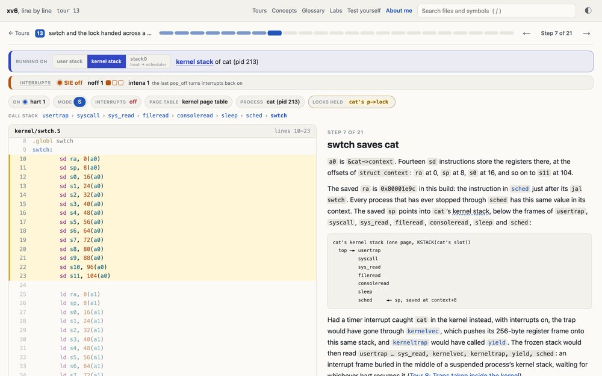

### [µSystem 8086](https://8086.jyotiprakash.org)

*A cycle-accurate 8086/8088 computer you build chip by chip, wire by wire, in a single HTML file. Boots FreeDOS.*

**What students struggle with.** Microprocessor courses teach bus cycles, address decoding, interrupts and DMA, but students rarely get to wire a real system and watch the signals. Hardware trainer kits are fixed boards with fixed chips, and a wiring mistake is hard to see.

**Why I built it.** I wanted a tool that replaces the trainer kit: students get the parts instead of a finished board, and every wire carries a real logic level. Nothing about the board is declared; the address map is found by driving the student's own decode gates, so a wrong wiring shows up the way it would on an oscilloscope.

**What it does**

- CPU core is 100.00% exact on the full SingleStepTests/8088 suite: 3,007,000 cases, every documented and undocumented instruction and every undefined flag bit
- Period chips placed and wired pin by pin: 8086/8088, 8284A, 8237A DMA, 8259A, 8253, 8255, SRAM/EPROM, 74LS glue logic, Hercules video, µPD765 floppy controller, XT keyboard
- The PC/XT preset runs GLaBIOS from EPROM, loads the boot sector over DMA channel 2 and boots FreeDOS 1.3
- Twenty-one preset boards, from a ripple counter to the PC/XT; nine ship a guided lab
- Design rule checks for shorts, bus contention, floating inputs and partial decode
- Step by clock half-cycle or by instruction, rewind the whole machine, probe any wire, and read a waveform analyzer
- A built-in 8086 assembler; turbo mode reaches real 8088 speed
- An illustrated guide of 13 sections with 570 screenshots captured from the running tool; twenty colour themes
- One static HTML file, no server and no install

**Built with:** Vanilla JavaScript, no dependencies, Single-file build (node build.mjs), Headless Chromium tests, GitHub Pages.

Live at https://8086.jyotiprakash.org · source: https://github.com/ShowMeTheStack/usystem-8086 · GPL-3.0-or-later (embeds GLaBIOS GPL-3, FreeDOS 1.3 boot disk GPL-2+)

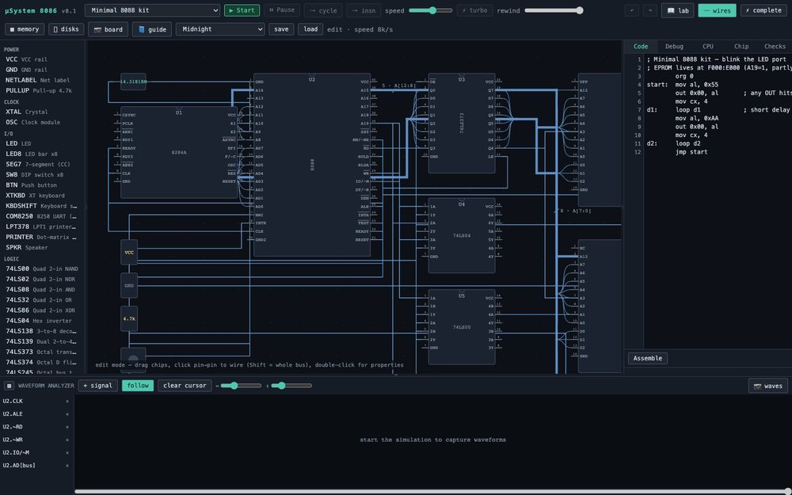

### [NetSim](https://netsim.jyotiprakash.org)

*A browser-based, client-side IPv4 network simulator for learning. Build topologies, watch real protocols run packet by packet, inspect every frame.*

**What students struggle with.** The hard parts of networking are the parts a textbook cannot show: timing, the state each device keeps, and what happens when things go wrong. A diagram of the TCP handshake does not show slow start backing off after a loss, and a static capture does not let a student pause, change one setting, and run it again.

**Why I built it.** I teach computer networks and wanted Packet Tracer style topology building and Wireshark style inspection in one tool, with a clock the student controls and protocol implementations that are readable code rather than black boxes.

**What it does**

- Deterministic discrete-event engine in integer microseconds, run in a Web Worker; play, run until quiet, step one event or one packet
- Byte-accurate packet codecs; a sniffer on any link, layered decode with hex highlighting, and a physical-layer view (NRZ, NRZI, Manchester)
- Conditional breakpoints that stop the moment a matching packet appears
- Routing with static routes, RIP, OSPF and BGP (eBGP, iBGP, route reflectors); NAT with port forwarding
- TCP with Tahoe, Reno, NewReno, CUBIC and SACK, with congestion window and sequence charts
- DHCP, a real DNS hierarchy with a recursive resolver, and HTTP with a request waterfall
- Switches with MAC learning and 802.1Q VLANs; switch logic can be replaced by sandboxed user JavaScript
- 802.11-style wireless with carrier sense, backoff, RTS/CTS and the hidden-node problem
- Real C socket programs compiled in the browser (clang) and run on the simulated network, including fork, pthreads, select, poll and epoll
- 81 guided labs in 19 modules, each checked by a test that it can be completed; 40 colour themes

**Built with:** TypeScript, React, Vite, Zustand, Web Worker, clang in the browser for C programs, Playwright end-to-end tests.

Live at https://netsim.jyotiprakash.org · source: https://github.com/ShowMeTheStack/netsim · GPL-3.0-or-later

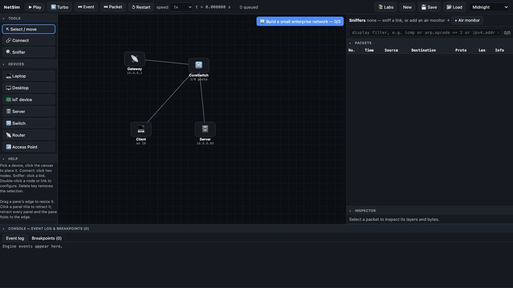

### [Compy](https://compy.jyotiprakash.org)

*A compiler you can watch: C89 through tokens, AST, types, IR, optimization passes and RISC-V, plus a language lab for automata and parsing.*

**What students struggle with.** In a compilers course the hard part is not any single algorithm. It is holding the whole pipeline in one's head and believing that each stage does what the lecture says. A listing of LR items in a textbook is inert.

**Why I built it.** I wrote the whole toolchain, from the preprocessor to the register allocator to the machine simulator, for this tool, so that every intermediate result is available to draw. Students can then see the state the parser is in, with the stack and the remaining input beside it, and argue with it.

**What it does**

- A live phase bar: Source, Tokens, Preprocess, Parse, Types, IR, Optimize, Codegen, Run
- A complete C89 preprocessor and hand-written recursive-descent parser; struct layouts drawn with padding (ILP32)
- A typed three-address IR in the style of LLVM, shown as text or as a control-flow graph
- Eight switchable optimization passes (simplify-CFG, mem2reg/SSA, inlining, constant folding, strength reduction, CSE, DCE, LICM) with before/after diffs
- RISC-V RV32IM+F/D back end with naive and linear-scan register allocators, a live-interval chart and a machine stepper
- Three execution engines (AST interpreter, IR interpreter, RISC-V simulator) over one checked process-memory model that catches null dereference, out-of-bounds, use-after-free, double free and leaks
- A reversible debugger that steps forwards and backwards on all three engines
- A language lab: regex to NFA to DFA to minimal DFA, FIRST/FOLLOW, grammar transformations, nine parsers (LL(1), LR(0), SLR, LR(1), LALR(1), Earley, CYK, operator precedence, recursive descent) and a PDA
- 32 compiler lessons and 19 language-lab lessons
- Differential testing against clang -std=c89, and a 3,669-case end-to-end browser suite

**Built with:** TypeScript, React, Vite, CodeMirror, npm workspace of nine packages, Vitest and Playwright.

Live at https://compy.jyotiprakash.org · source: https://github.com/ShowMeTheStack/compy · GPL-3.0-or-later with an attribution term

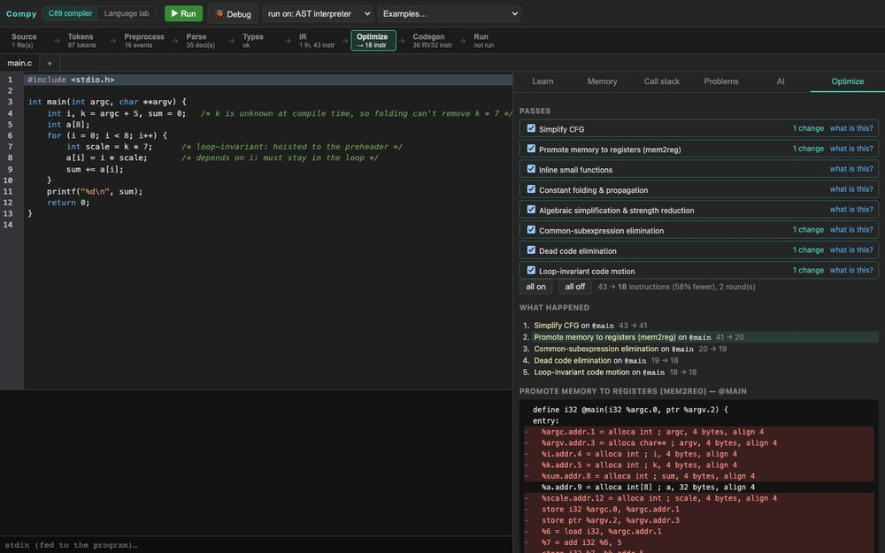

### [Baysik](https://baysik.jyotiprakash.org)

*A GW-BASIC and QBasic programming environment in a single HTML file.*

**What students struggle with.** Beginners need a first language with an immediate, visible result, but running classic BASIC today means installing DOSBox and finding an old interpreter. Old interpreters also give a learner little help in seeing what a program is doing.

**Why I built it.** I learned to program on Logo and then BASIC, and wanted something I could hand to a child, a student, or an old hand without asking anyone to install anything. I also wanted a debugger that shows every frame of a recursion and lets the learner change any value.

**What it does**

- One combined language: all of QBasic 1.1 plus GW-BASIC line-numbered features and some QuickBASIC extras
- Every QBasic screen mode at its real resolution and colour limits (SCREEN 0 to 13), drawn with the IBM ROM fonts
- PC speaker sound through Web Audio, with the full Music Macro Language for PLAY
- A debugger with breakpoints, conditional breakpoints, step into/over/out, and editing of variables in any stack frame
- A GW-BASIC classic console with LIST, RUN, RENUM, AUTO and soft keys
- A DOS-style disk in the browser, plus optional mounting of a real folder with read-only, ask, or write permission
- 527 hand-written, commented programs in 21 categories
- A 57-lesson tutorial in 16 units, guided tours and a language reference with runnable examples
- Compiler to bytecode plus a virtual machine, so a program can pause between any two statements

**Built with:** Vanilla JavaScript, no framework or dependencies, Single-file build of about 2 MB, Headless Chrome end-to-end tests, GitHub Pages.

Live at https://baysik.jyotiprakash.org · source: https://github.com/ShowMeTheStack/baysik · GPL-3.0-or-later with an attribution term

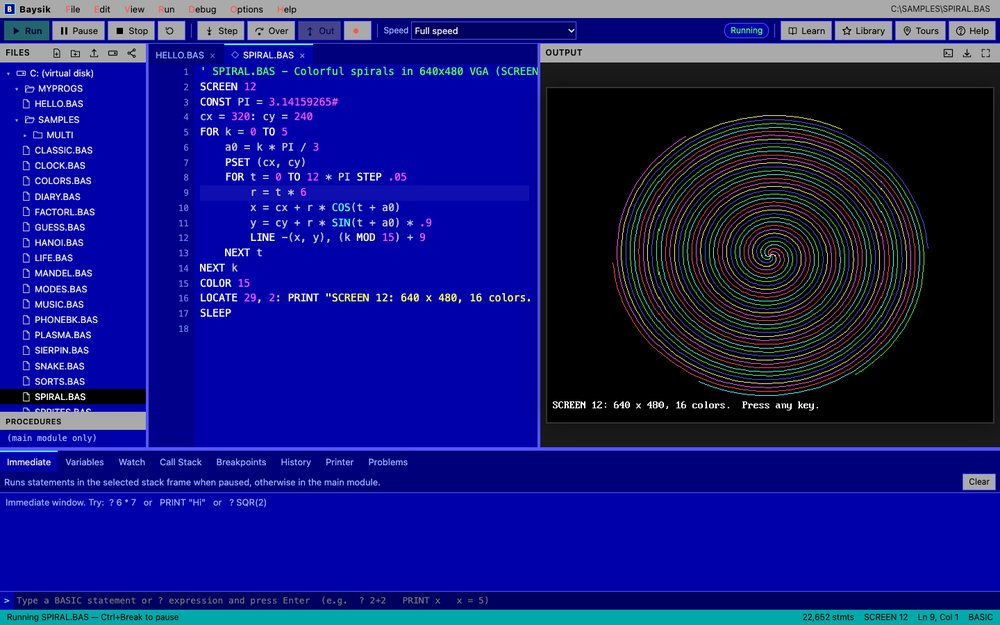

### [Lohgo](https://lohgo.jyotiprakash.org)

*A Logo programming studio in one HTML file: turtle graphics, a debugger that walks through recursion, 68 lessons and 504 example programs.*

**What students struggle with.** Recursion is where many learners get stuck, and Logo is where many first meet it. Without a way to see each waiting copy of a procedure, recursion stays abstract.

**Why I built it.** Logo was my first language. I wanted a studio I could hand to a child, to a student meeting recursion for the first time, or to someone who remembers the turtle from an Apple II, with nothing to install and a debugger that shows every active frame.

**What it does**

- Follows Berkeley Logo (UCBLogo), including its error wording, so books written for it work
- 375 primitives, each with a reference page and a runnable example
- Turtle, colour and event commands from MSWLogo/FMSLogo, and multiple turtles from LCSI Logo
- A debugger with breakpoints, conditional breakpoints and stepping; the call stack shows every waiting procedure with its own inputs, and values can be edited
- A classic command center (listener) with history and completion
- 504 commented programs in 21 categories
- A course of 68 lessons in 16 units, ending with building a game
- Files on a browser disk, PNG export, and phone and tablet layouts

**Built with:** Vanilla JavaScript, no framework or dependencies, Single-file build, GitHub Pages.

Live at https://lohgo.jyotiprakash.org · source: https://github.com/ShowMeTheStack/lohgo · GPL-3.0-or-later with an attribution term

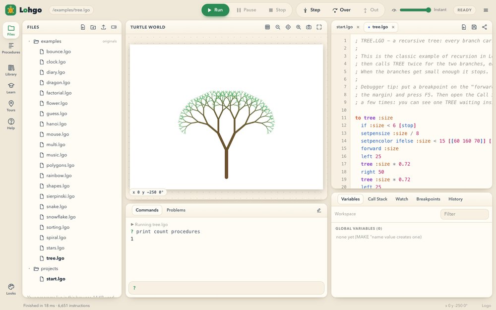

### [See](https://see.jyotiprakash.org)

*A C89 workbench in the browser. Compile, run and step through C, and watch the stack, the heap and every pointer at real addresses.*

**What students struggle with.** The hardest part of learning C is not syntax. It is the picture in the head: where a variable lives, what a pointer holds, why char s[] = "hi" can be changed and char *p = "hi" cannot, and what free does to a pointer that still holds the address.

**Why I built it.** I have taught C for many years and wanted a tool that draws that picture for every program, from real bytes rather than a diagram made for the occasion, with no install, server or account.

**What it does**

- Its own C89 compiler, linker and C library, running on a simulated 32-bit machine laid out like classic Unix (code at 0x08048000, stack down from 0xc0000000, i386 calling convention)
- A memory picture of every stack frame, heap block, global, string literal and function, with arrows from every pointer
- Stepping backwards (F8): memory, heap, frames, input and output all return to their earlier state
- Every load and store is checked; null dereference, out-of-bounds, use-after-free, double free, writes to read-only data, stack overflow and dangling pointers are stopped and explained
- gcc -Wall style warnings, including printf/scanf format mismatches
- Watchpoints, conditional breakpoints, a hover card with the line that last wrote a value, and a raw bytes view
- 100 lessons in 15 units, and more than 600 commented programs in 22 categories including a find-the-bug section
- A full C89 library reference, multi-file projects with real linking, and share links that carry the whole project
- Phone and tablet layouts

**Built with:** Vanilla JavaScript, no framework or dependencies, Single-file build, GitHub Pages.

Live at https://see.jyotiprakash.org · source: https://github.com/ShowMeTheStack/see · GPL-3.0-or-later with an attribution term

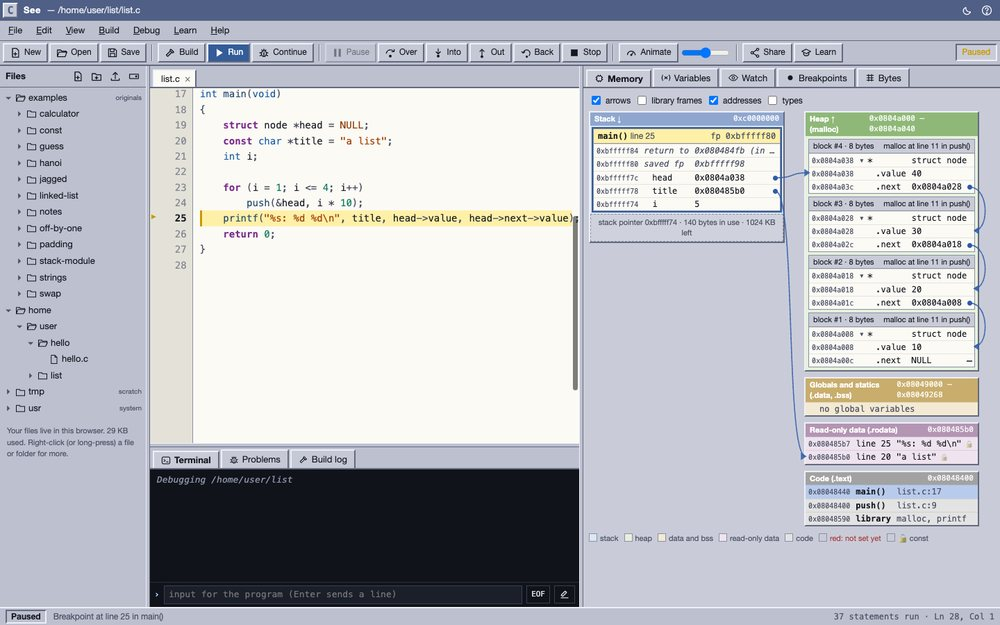

### [Strux](https://strux.jyotiprakash.org)

*Data structures and algorithms in C89, animated from real running code.*

**What students struggle with.** Students rarely struggle with the idea of a linked list or a heap. They struggle with the moment: which pointer changes first, what is lost if the order is wrong, why a deleted slot in a hash table must not look empty. A whiteboard shows only the before and the after.

**Why I built it.** I have taught data structures for many years and wanted to show every step in between, forwards and backwards, drawn from the memory of the real program rather than from a hand-made animation.

**What it does**

- 175 topics in ten groups: arrays, linked lists, stacks and queues, searching, sorting, hashing, trees, balanced trees (AVL, red-black, B, B+, splay, treap), heaps and tries, graphs
- Runs on See's C89 compiler and 32-bit machine; the picture is drawn from program memory after every line
- A narration sentence for each step with the actual numbers, and counters for comparisons, swaps, moves, pointer steps, mallocs and frees
- Memory and Calls tabs, including the recursion tree of every call made so far
- Prediction questions at key moments, and a 4 to 6 question quiz per topic
- Compare mode runs two topics side by side on the same data
- Courses that order topics, and a graph editor for drawing one's own graph
- Projector mode, dark and light themes, and phone and tablet layouts

**Built with:** Vanilla JavaScript, See's C89 compiler and simulated machine, Single-file build, GitHub Pages.

Live at https://strux.jyotiprakash.org · source: https://github.com/ShowMeTheStack/strux · GPL-3.0-or-later with an attribution term

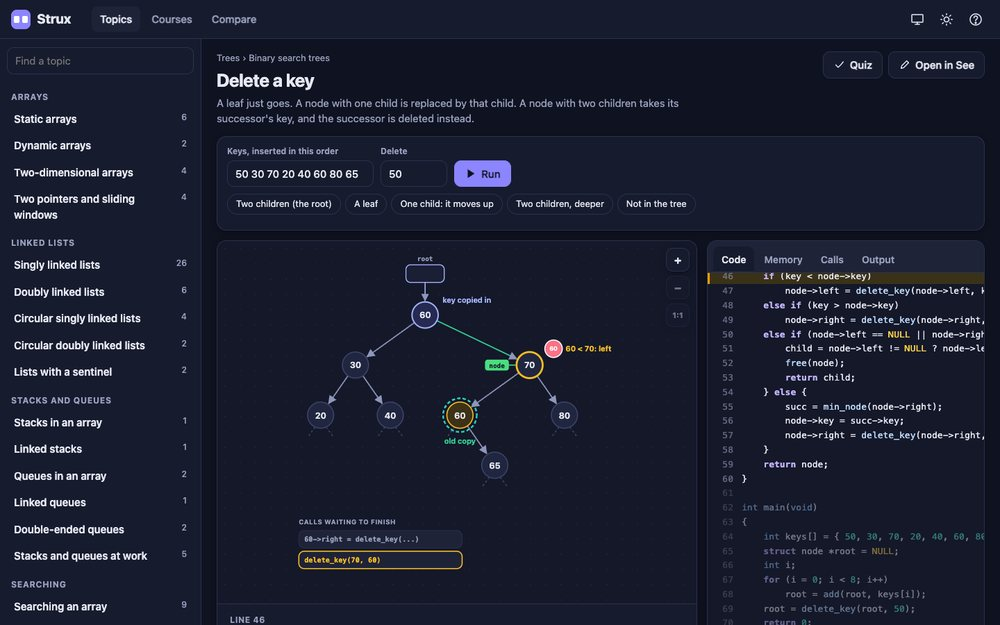

### [Kwery](https://kwery.jyotiprakash.org)

*A relational database you can see into, from SQL down to the pages.*

**What students struggle with.** Students learn SQL quickly. What they struggle with is everything a real database hides: why the optimizer chose a hash join, what a dirty page is, why one transaction waits and another does not, what happens to the log on restart.

**Why I built it.** I teach the database course and wanted every one of those ideas shown on a real engine, one step at a time, on data small enough to follow and large enough to matter.

**What it does**

- SQL in PostgreSQL's dialect, its answers tested against PostgreSQL 17 on more than five thousand statements
- A cost-based optimizer, pipelined executor, B+ tree, hash, bitmap, LSM and R-tree indexes, a buffer manager over slotted pages, MVCC with locks, a write-ahead log and ARIES recovery
- Views of the plan with its cost formulas, the pages and tuples, the buffer pool, every index structure, the waits-for graph and the log, all recorded so a run can be stepped backwards
- Concurrency protocols from two-phase locking to serializable snapshot isolation, schedules with their precedence graphs, and crashes with a basic or ARIES restart
- An E-R editor in three notations, functional dependencies and normal forms, and relational algebra and calculus
- A simulated cluster: partitioning, replication, two- and three-phase commit, Raft, distributed queries and MapReduce
- Lessons for all 26 chapters of the course, over four hundred exercises checked by running them on altered copies of the data, and guided tours
- Original sample databases (Theatre, a credit union, a software studio and more), dark and light themes, and phone layouts

**Built with:** Vanilla JavaScript, A database engine written for the purpose, Single-file build, GitHub Pages.

Live at https://kwery.jyotiprakash.org · source: https://github.com/ShowMeTheStack/kwery · GPL-3.0-or-later with an attribution term

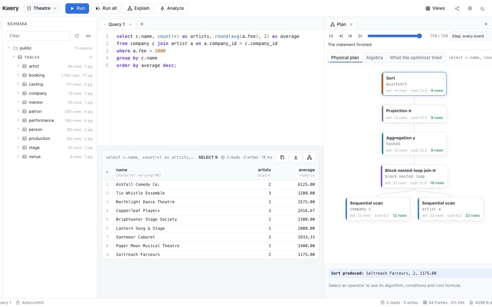

### [Tooring](https://tooring.jyotiprakash.org)

*Theory of computation you can play with, from automata to NP-completeness.*

**What students struggle with.** Students find the theory of computation dry. They can recite the subset construction or the pumping lemma, but they never see it happen: which states an NFA is in after the third symbol, why a pair is marked in round two, what the diagonal machine does with its own description.

**Why I built it.** I teach the course and wanted every proof and construction acted out on screen, forwards and backwards, on any input a student types.

**What it does**

- 206 topics in seven parts, each with its own picture and a sentence per step with the actual states and symbols
- Engines written for the purpose: finite automata and regular expressions, normal forms, CYK, Earley, LL(1) and the whole LR family, pushdown automata, Turing machines and their variants, register machines, recursive functions and the lambda calculus
- Editors for automata, PDAs, Turing machines, expressions and grammars, with conversions, minimisation and comparison that finds a counterexample
- Games: the pumping lemmas, Myhill–Nerode, PCP dominoes, tilings, busy beavers and reductions built as gadgets
- The halting problem, Rice's theorem, Cook–Levin and the classic NP-complete reductions acted out on screen
- 140 lessons and 528 exercises checked automatically, with hints, plus guided tours and courses
- Predictions before each step, dark and light themes, phone and projector layouts

**Built with:** Vanilla JavaScript, Formal-language engines written for the purpose, Single-file build, GitHub Pages.

Live at https://tooring.jyotiprakash.org · source: https://github.com/ShowMeTheStack/tooring · GPL-3.0-or-later with an attribution term

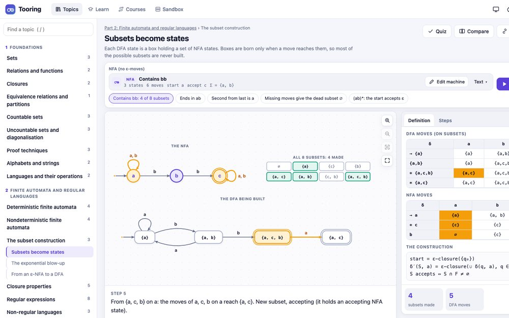

### [Sirkit](https://sirkit.jyotiprakash.org)

*Digital design you can build, run and see inside, from gates to a small processor.*

**What students struggle with.** Students can draw an AND gate and write a truth table on day one. What stays abstract is everything between the inputs and the outputs: why a K-map group is not prime, why a flip-flop changes only at the edge, why a ripple adder is slow, why a glitch appears on a wire that should stay at 1.

**Why I built it.** I teach digital design and wanted every wire to show its value, every gate to take its time, and every step of minimisation and state machine design to be something students do and the tool checks.

**What it does**

- A drag-and-drop circuit editor: every part's parameters editable, an event-driven simulator with 0, 1, X and Z, gate delays, setup and hold checks, and waveforms
- Technology presets (CMOS, TTL, LS-TTL, FPGA-like), static timing and the critical path
- A function workbench: truth tables, SOP and POS, K-maps up to six variables that students circle and the tool checks, Quine-McCluskey, and algebraic proofs step by step
- State machine design from word problem to circuit, ASM charts, asynchronous circuits and hazards
- Verilog-2005 with testbenches, checked against a reference simulator, synthesised to drawn circuits
- A breadboard lab bench with 74-series chips, a logic analyser and bench experiments
- Switch-level CMOS, logic families, and a small processor with hard-wired and microprogrammed control
- 200 animated topics, about 150 lessons and over 500 exercises checked automatically, with tours and courses

**Built with:** Vanilla JavaScript, A logic simulator and Verilog compiler written for the purpose, Single-file build, GitHub Pages.

Live at https://sirkit.jyotiprakash.org · source: https://github.com/ShowMeTheStack/sirkit · GPL-3.0-or-later with an attribution term

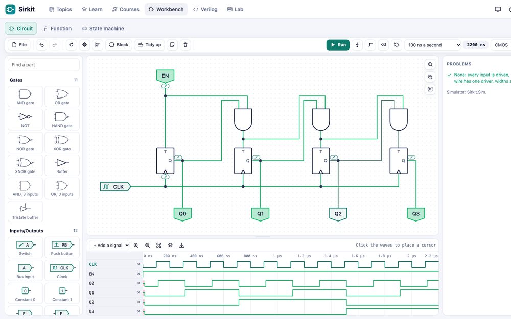

### [Sifer](https://sifer.jyotiprakash.org)

*Cryptography you can see inside, from the Enigma to post-quantum schemes.*

**What students struggle with.** Students meet cryptography as formulas and black boxes: AES encrypts, RSA is hard, a signature verifies. What they never see is the state after each round, why a bit flip spreads, why a nonce must never repeat, or what makes one parameter choice safe and another fatal.

**Why I built it.** Cryptography is my doctoral advisor's field and close to my own research on side channels. I wanted every value on the screen and every security rule shown with the reason it exists.

**What it does**

- 15 parts from classical ciphers and the Enigma through number theory, stream and block ciphers, modes, RSA, discrete logarithms, elliptic curves, signatures, hashes, MACs and protocols, post-quantum schemes and secure implementation
- Engines written for the purpose that reproduce the published vectors of FIPS 197, SP 800-38A/D, FIPS 180-4, FIPS 202, FIPS 203, RFC 7748, 8032, 8439, 5869, 6979, 8448 and more, and agree with a standard library value for value
- Animated topics: the AES state round by round, the DES Feistel ladder, the ChaCha quarter-round, SHA-256 and Keccak, curve addition, ML-KEM data flow, TLS 1.3 key schedule
- Benches for ciphers and modes, number theory, public key, curves, hashes and protocols, with every intermediate value
- Enigma I with its inside view and signal path, and a working Bombe that recovers the key from a crib
- Lessons and auto-checked exercises, a code sandbox tested against vectors, a challenge ladder, tours and courses
- Dark and light themes, phone and projector layouts

**Built with:** Vanilla JavaScript, Cipher, hash, curve and lattice engines written for the purpose, Single-file build, GitHub Pages.

Live at https://sifer.jyotiprakash.org · source: https://github.com/ShowMeTheStack/sifer · GPL-3.0-or-later with an attribution term

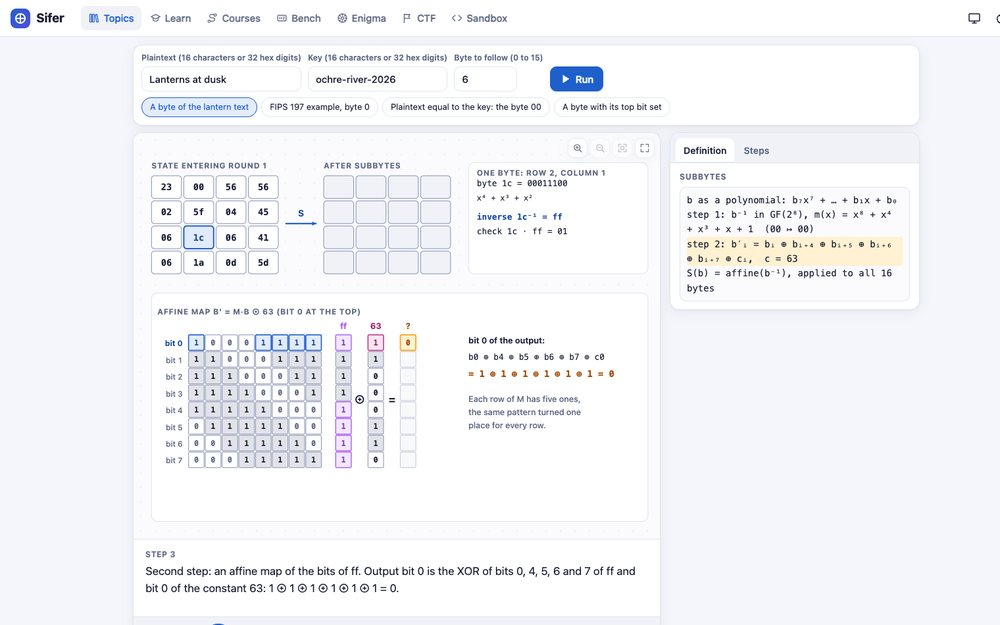

### [Nooral](https://nooral.jyotiprakash.org)

*Machine learning you can see inside, from least squares to a tiny GPT trained in the browser.*

**What students struggle with.** Students meet machine learning as a library call that prints a score. They can quote an accuracy, but never see the boundary behind it, the rows it got wrong, what a split, a weight or an attention head is doing, or how any of it changed during training.

**Why I built it.** My students reach machine learning through libraries long before they understand what a model does. I wanted them to build and question real models without writing code first, with every intermediate value on the screen and every claim backed by the numbers the model actually produced.

**What it does**

- 18 parts from data and evaluation through linear models, neighbours, trees and ensembles, SVMs, clustering and PCA, optimisation, neural networks, CNNs, sequences, transformers and language models, to generative models, reinforcement learning, graph networks, robustness and privacy, and practice
- A no-code workflow canvas: datasets, splits, preprocessing, 19 models, training, evaluation and comparison, with confusion matrices whose cells list the very rows
- Its own tensor library with reverse-mode autodiff, WebGPU kernels and a CPU fallback, training in Web Workers
- A text lab that tokenises with BPE and trains a small GPT in the browser, with attention and sampling visible
- Animated topics with a sentence under every step giving the actual values, checked against the engines
- Lessons, auto-checked exercises, model challenges on hidden test sets, tours and courses
- Dark and light themes, phone and projector layouts

**Built with:** Vanilla JavaScript, Tensor, autodiff and model engines written for the purpose, WebGPU and WebAssembly, Single-file build, GitHub Pages.

Live at https://nooral.jyotiprakash.org · source: https://github.com/ShowMeTheStack/nooral · GPL-3.0-or-later with an attribution term

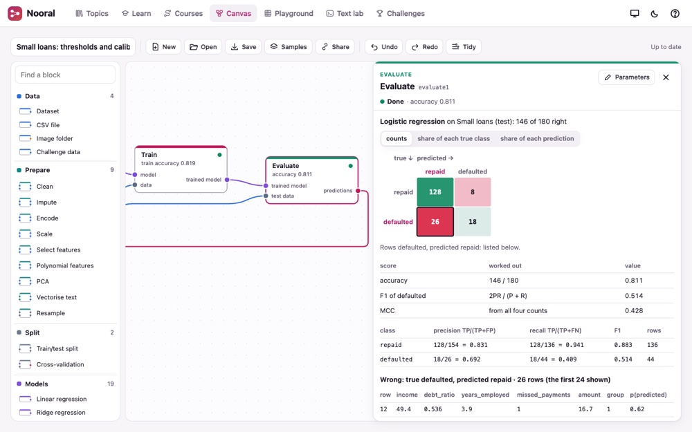

### [Proses](https://proses.jyotiprakash.org)

*Operating systems you can see inside: every mechanism a small machine you set up, run a step at a time and break.*

**What students struggle with.** Students meet operating systems as definitions and diagrams that never move. They can recite the states of a process or the rows of the banker's algorithm, but rarely watch one happen, and a fork program that prints in a surprising order stays a puzzle.

**Why I built it.** I teach operating systems at KIIT and taught it before as a teaching assistant at UW-Madison. I wanted every mechanism to run, with every input the student's to change, as the concept-level companion to xv6, line by line.

**What it does**

- 18 parts from the hardware boundary through processes, IPC and signals, threads, scheduling, multicore and real time, synchronisation, the classic problems, deadlocks, main and virtual memory, storage, I/O, file systems, distributed file systems, protection (taught defensively) and virtual machines
- Ten labs: Process, Shell, Scheduler, Sync, Deadlock, Memory, Virtual memory, Storage, File system and VM, each with typed input, presets and share links
- Real C programs run on an interpreter and simulated kernel: fork trees, zombies and orphans, pipes, signals, threads, and every output a program can print, checked against programs compiled and run on a real machine
- A model checker that searches every schedule of a student's own synchronisation code and replays the shortest failing one or a starvation cycle
- Animated topics with a sentence under every step giving the actual values, each checked against the engines
- Lessons, auto-checked exercises, challenges with hidden tests, tours and courses
- Dark and light themes, phone and projector layouts

**Built with:** Vanilla JavaScript, A C interpreter, simulated kernel, model checker and OS engines written for the purpose, Web Workers, Single-file build, GitHub Pages.

Live at https://proses.jyotiprakash.org · source: https://github.com/ShowMeTheStack/proses · GPL-3.0-or-later with an attribution term

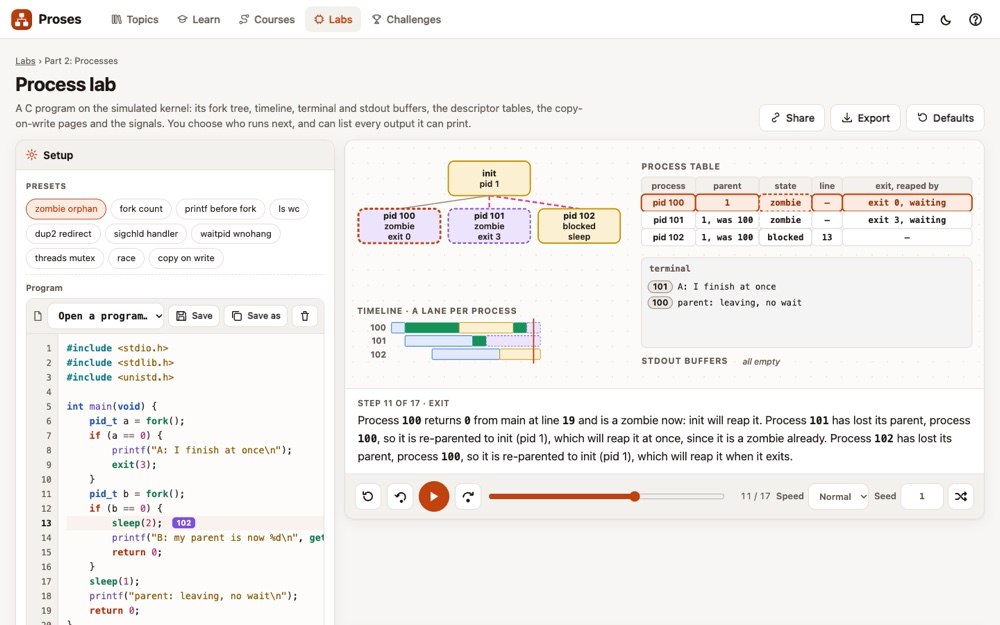

### [Arkitek](https://arkitek.jyotiprakash.org)

*Computer organization you can see inside, from an instruction's bits to pipelines, caches and GPUs.*

**What students struggle with.** Students meet computer organization as block diagrams that never move. They can draw the five pipeline stages or the fields of a cache address, but rarely watch an instruction flow through a datapath, a carry ripple through an adder, or a miss turn out to be a conflict miss.

**Why I built it.** I teach this course at KIIT and the whiteboard runs out of room: I can draw one cycle or one Booth step, but the interesting part is the next forty cycles, or what changes when forwarding is turned off. I wanted every unit to run, with every input the student's to change and every value checked against real tools.

**What it does**

- 23 parts from abstractions and performance through the RISC-V instruction set, the toolchain, number representations, every adder, the ALU, every multiplier and divider and full IEEE 754, bus-based and multi-stage datapaths on a teaching ISA of its own, control-unit design, the RISC-V datapath, pipelining, hazards and ILP, caches, virtual memory, parallel processors and GPUs
- 21 labs, among them an Instruction lab, a Toolchain lab, Adder, Multiplier, Divider and Floating-point labs, Datapath, Pipeline and Multiple-issue labs, a Cache lab and a Control-unit studio with a logic analyser
- A RISC-V RV64IMAFD simulator with vectors and privileged modes, checked commit by commit against spike and the official riscv-tests, and an assembler and linker checked against the GNU toolchain
- Floating point in any format and every rounding mode, bit-exact against Berkeley TestFloat
- Animated topics with a sentence under every step giving the actual values, each checked against the engines
- Lessons, auto-checked exercises, challenges with hidden tests, tours and courses
- Dark and light themes, phone and projector layouts

**Built with:** Vanilla JavaScript, RISC-V, Arka, arithmetic, pipeline, cache and GPU engines written for the purpose, Single-file build, GitHub Pages.

Live at https://arkitek.jyotiprakash.org · source: https://github.com/ShowMeTheStack/arkitek · GPL-3.0-or-later with an attribution term

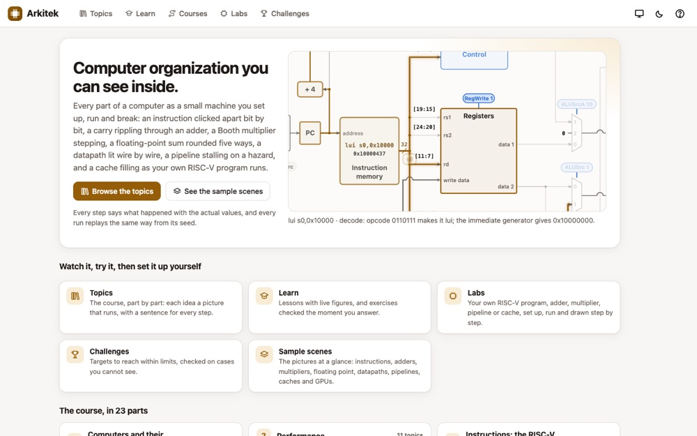

## Experience

### Co-founder and CEO, ENineHQ Technologies Pvt. Ltd.

*2022 to now, Bhubaneswar, India*

- Founded and lead an engineering company with three lines of work. The hardware arm designs custom silicon, RISC-V processors, FPGA prototypes and production-ready systems on chip, with a focus on open instruction sets and hardware security.
- Healthcare software: clinical-grade systems including electronic health records, pharmacy management, laboratory information systems and patient-facing applications built for real medical workflows.
- Security research consultancy: offensive security training, threat modelling, architecture reviews and support for academic research.
- Develop and publish consumer software on the Google Play Store: utilities, emulators and learning apps.

### Assistant Professor (Senior Scale, Academic Level 11), Kalinga Institute of Industrial Technology (KIIT)

*Sep 2020 to now, Bhubaneswar, India*

- Teach core computer science courses (computer architecture, operating systems and programming) to undergraduate and graduate students.
- Conduct and publish research in hardware security, RISC-V, malware analysis and cryptography; present at international conferences.
- Pursue research and industry funding; responsibility for examinations and faculty recruitment interviews.

### Team Lead, Epic Systems

*Jul 2018 to Jan 2020, Madison, Wisconsin, USA*

- Led the team developing specialty healthcare software for Epic's international customers.
- Design and code reviews, development, appraisals and people management; weekly and quarterly progress reviews.

### Software Developer, Epic Systems

*Jun 2016 to Jul 2018, Madison, Wisconsin, USA*

- Developed the Java backend serving medical data to the Android front end of Epic's Rover software, including Java bindings for operations on the Caché (M) tree-structured database.
- Designed backend software for complex data migration between patient contacts; improved performance and supportability with QA and performance engineers.
- Evaluated architectural alternatives in early design and delivered several large medical projects while overseeing other developers.

### Software Development Intern, Epic Systems

*Jun 2015 to Aug 2015, Madison, Wisconsin, USA*

- Summer internship during the MS on Epic's mobile healthcare applications, Rover and Haiku, on iOS and Android. Returned full time on graduating.

### Graduate Teaching Assistant, University of Wisconsin-Madison

*Aug 2014 to May 2016, Madison, Wisconsin, USA*

- Taught operating systems concepts, set and graded examinations and weekly assignments, and held office hours.

### Senior Member of Technical Staff, Oracle

*Jun 2010 to Mar 2014, Bangalore, India*

- Wrote specifications for and developed modules of Oracle Web Services Manager (OWSM), which secures SOAP web services across WebLogic, JBoss and WebSphere.
- Implemented management APIs of Oracle Entitlements Server (OES) for fine-grained authorization; fixed more than 200 bugs in time-constrained release cycles.
- Promoted to Senior Member of Technical Staff.

### Software Development Intern (Practice School II), Yahoo! Labs

*2009 to 2010, Bangalore, India*

- Built Java software to find lists and tables in arbitrary web documents and extract them as maps, in the Web Extraction Technologies project.
- Developed a document annotation system for tagging, searching and highlighting words, sentences and paragraphs in web documents.

### Summer Research Intern, Bhabha Atomic Research Centre, Computer Division

*2008 to 2008, Mumbai, India*

- Selected among 16 students nationwide for BARC's summer internship programme.
- Designed an iterative algorithm to generate structured 3D grids on parametric surfaces bounded by four cubic splines; validated on a BARC supercomputer.

**ENineHQ, what it does**

- **Hardware Engineering:** Custom RISC-V cores, FPGA prototyping, Hardware security and side-channel analysis, SoC integration and verification
- **Healthcare Software:** Electronic health records for ambulatory and OPD settings, Pharmacy management, Laboratory information systems, Patient-facing mobile and web apps
- **Security Research:** Security training and workshops, Tooling guidance, Research publication support, Threat modeling and architecture review

## Education

### PhD in Computer Science, BITS Pilani

*2021 to 2026. Thesis submitted; award expected December 2026.*

- Thesis: An Investigation of Side-Channel Security in Open-Source RISC-V Processors.
- Sixteen publications, six published patent applications and two textbooks during the doctorate.

### MS in Computer Science, University of Wisconsin-Madison

*2014 to 2016. GPA 3.9 / 4.0.*

- Graduate study concentrated in systems.
- Fully funded through a teaching assistantship guaranteed in the admission offer; TA for Introduction to Operating Systems throughout.

### BE (Hons.) in Computer Science, BITS Pilani

*2006 to 2010. CGPA 9.53 / 10, with distinction.*

- Perfect 10.0 across the first year; graduated with distinction.
- Course topper in Advanced Computer Organization, Microprocessor Programming and Interfacing, Programming Languages and Compiler Construction, Discrete Mathematics, Computational Physics, and Embedded Systems Design.
- Final-semester project with Dr. Sanjay K. Sahay on network security: PKI, TLS, VPNs, firewalls and Kerberos, with working demonstrations in C on GNU/Linux and a study of netfilter/iptables.
- Practice School at Bhabha Atomic Research Centre (PS-I) and Yahoo! Labs, Bangalore (PS-II).

### Higher Secondary (Science), CHSE Odisha, BJB College

*2004 to 2006. 4th in the state.*

### ICSE (Class 10), BSHS, Puri

*1998 to 2004. School topper, 96%.*

## Teaching and outreach

- **YouTube, [Jyotiprakash Mishra CS](https://www.youtube.com/@jyotiprakashmishracs):** 78 lectures and more than 437,000 views. Series: Operating Systems, Computer Networks, Data Structures and Algorithms.
- **[blog.jyotiprakash.org](https://blog.jyotiprakash.org):** Long-form articles on computer science fundamentals and systems: C programming, operating systems, computer architecture, networking, Java and Spring Boot, plus occasional physics and quantum computing. Running for about three years.
- **KIIT, since 2020:** computer architecture, operating systems and programming, for undergraduate and graduate students.
- **UW-Madison, 2014 to 2016:** teaching assistant for Introduction to Operating Systems.

Some posts:

- [Quantum Computers, From First Principles: What They Are and What They Provably Run Faster](https://blog.jyotiprakash.org/quantum-computers-from-first-principles-what-they-are-and-what-they-provably-run-faster)
- [Why Energy and Momentum Are Conserved: Noether's Theorem, Derived by Hand](https://blog.jyotiprakash.org/why-energy-and-momentum-are-conserved-noether-s-theorem-derived-by-hand)
- [Computer Arithmetic: From Fast Adders to Floating-Point](https://blog.jyotiprakash.org/computer-arithmetic-from-fast-adders-to-floating-point)
- [The Complete Memory Hierarchy: From Semiconductor RAM to Virtual Memory](https://blog.jyotiprakash.org/the-complete-memory-hierarchy-from-semiconductor-ram-to-virtual-memory)
- [The Ultimate Spring Boot Guide: From Fundamentals to Production-Ready REST APIs](https://blog.jyotiprakash.org/the-ultimate-spring-boot-guide-from-fundamentals-to-production-ready-rest-apis)
- [Understanding Functions, Memory, and Pointers in C: A Complete Guide](https://blog.jyotiprakash.org/understanding-functions-memory-and-pointers-in-c-a-complete-guide)
- [Datapath and Control](https://blog.jyotiprakash.org/datapath-and-control)
- [Demystifying Instruction Set Architecture](https://blog.jyotiprakash.org/demystifying-instruction-set-architecture)
- [Socket Programming in Java: Understanding TCP Communication](https://blog.jyotiprakash.org/socket-programming-in-java-understanding-tcp-communication)

## Honours

- 4th rank statewide, Council of Higher Secondary Education (Science) examination, Odisha, 2006.
- School topper, ICSE (96%), 2004.
- Among the top 300 nationwide, National Standard Examination in Chemistry (NSEC), 2005.
- Perfect 10.0 CGPA in the first year at BITS Pilani; course topper in several core courses.
- Selected among 16 students nationwide for the BARC summer research programme, 2008.

## Skills

- **Research:** hardware security, microarchitectural side channels, memory encryption, malware detection, cryptography, formal verification
- **Architecture and hardware:** RISC-V ISA and microarchitecture, Verilog / RTL, FPGA, embedded systems, x86 and AVR assembly
- **Systems:** OS and kernel development (xv6, Linux), systems programming in C, cycle-accurate emulation
- **Software engineering:** Java, Spring Boot, microservices, Docker, system design, code review, team leadership
- **Teaching:** computer architecture, operating systems, programming, cryptography, curriculum and examination design

## Languages

English (fluent), Odia (native), Hindi (fluent)

## Contact

Email [mail@jyotiprakash.org](mailto:mail@jyotiprakash.org). I am glad to hear from students, researchers, and anyone who found a bug in one of my tools.

## About this site

The page is one HTML file built from the data in `src/data/` by `node build.mjs`. The diagrams are drawn as vector graphics from small descriptions in `src/figs.js`; `node tools/diagrams.mjs` writes the copies used in this README, `node tools/readme.mjs` writes this README, and `node tools/check.mjs` tests the page in headless Chrome at nine screen sizes and in every theme.

Copyright © 2026 Jyotiprakash Mishra. All rights reserved. The text, the photographs and the diagrams may not be reused without permission.
